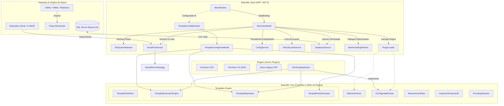

# Documentação de Arquitetura SelectML

Este documento serve como a "Fonte da Verdade" técnica para o projeto SelectML. Destina-se à equipe de engenharia e manutenção, detalhando decisões de arquitetura, fluxo de dados e integrações na versão **V1.2.8**.

---

## 1. Diagrama de Componentes (V1.2.8)

A arquitetura V1.2.8 consolida um ecossistema modular para recepção híbrida de dados (Arquivos de CMMs/VMMs e Medições Manuais Seriais), inspeção completa de rotinas do MeasurLink e parametrização universal por templates visuais interativos.

---

## 2. Fluxo de Dados (Data Flow)

O SelectML opera com um pipeline híbrido e adaptativo, garantindo governança total e zero perda de dados.

### 2.1 Fluxo de Arquivo (Máquinas Automáticas e Templates)
1. **Detecção**: O `FileSystemWatcher` detecta a chegada de novo arquivo no diretório monitorado.
2. **Auto-Detecção de Codificação**: O `EncodingDetector` avalia a presença de BOM e assinaturas para carregar o arquivo com precisão (UTF-8, Latin-1/ANSI).
3. **Parsing**: O plugin selecionado (`IMachineParser` ou `IConfigurableParser`) converte o arquivo para `MeasurementData`:
   - **ViciVision CSV**: Lê primeira e última linha.
   - **ViciVision JSON**: Estrutura JSON com extração de tolerâncias.
   - **Zeiss Calypso PDF**: Agrupamento espacial resiliente via `PdfPig` com limpeza de LaTeX.
   - **Motor Universal de Templates (`TextTemplateParser`)**: Executa regras estruturadas (horizontal ou linha a linha, tokens delimitados ou Regex compilado) usando o `TemplateExecutionEngine`.
4. **Validação e Enriquecimento SQL**: Consulta o SQL Server (`DatabaseService`) para associar a corrida/peça a uma rotina e estação ativa.
   - Se `ListAllFeatures` estiver ativo: mescla as características do arquivo com todas as cotas cadastradas na rotina do MeasurLink (`GetInspectionRoutineFeaturesAsync`), destacando nominais e limites.
5. **Aplicação de Modificadores de Nome**: Se habilitado, ajusta os rótulos de cotas adicionando diâmetros (`Ø`) e tolerâncias conforme regras de engenharia.
6. **Roteamento de Saída e Backup**: Grava o CSV final formatado na pasta configurada (`OutputDirectory` ou subpasta da Estação) e move o arquivo original para `/Backup`.

### 2.2 Fluxo Serial e Concorrência Híbrida (Paquímetros, Micrômetros e U-WAVE)
1. **Entrada Incremental**: `SerialPortService` recebe dados via RS-232 em thread dedicada.
2. **Reconhecimento de Comando de Desfazer (U-WAVE Undo)**:
   - A `UWaveStrategy` intercepta o comando específico de desfazer (ex: `CLR`, `CANCEL` ou padrão da botoeira).
   - Dispara o evento `UndoRequested`, desfazendo sequencialmente a última medição manual da tela sem exigir interação com mouse/teclado.
3. **Enfileiramento Controlado (`EnqueueSerialInput`)**:
   - **Modo Enfileirado (`true`)**: Medições sem peça aguardam no buffer reverso (`_serialBuffer`) até a definição do Lote/Peça.
   - **Modo Concorrente Híbrido (`false`)**: Permite entrada serial direta na tela mesmo com arquivos sendo preparados, viabilizando preenchimento de cotas manuais complementares antes ou depois do recebimento do arquivo de CMM.
4. **Preenchimento Sequencial Top-Down**:
   - Quando `ListAllFeatures` está ativo, as medições seriais preenchem automaticamente a primeira característica de variável ainda vazia da lista, de cima para baixo.

---

## 3. Componentes Chave da Versão V1.2.8

### 3.1 Motor Universal de Templates de Texto (Text Template Engine)
- **Visualizador Interativo com Highlighting**: A janela `TemplateConfigWindow` permite carregar um arquivo de amostra, inspecionar as linhas com marcações coloridas de regras e gerar regras automaticamente com clique de contexto.
- **Extração Granular de Sub-Linhas**: Suporta separadores padrão (`;`, `,`, `\t`, `|`, espaço) e expressões regulares com grupos de captura nomeados (`(?<feat>...)` e `(?<val>...)`).
- **Prévia em Tempo Real**: Painel inferior na biblioteca de templates atualizado instantaneamente a cada clique ou edição de regra.
- **Armazenamento de Templates**: Arquivos salvos em `%APPDATA%\SelectML\Templates\*.json`.

### 3.2 Listagem de Características da Rotina e Visualização de Tolerâncias
- **Query de Alta Performance**: `GetInspectionRoutineFeaturesAsync` recupera todas as cotas da rotina vinculada ao lote (`ActiveRun` ou `Run`), incluindo nominais, limites de tolerância superior/inferior (`LSL` / `USL`) e indicador de atributo.
- **Color Coding de Tolerância**: Destaque em tempo real no DataGrid:
  - 🟢 **Verde**: Valor medido dentro dos limites de especificação (`LSL <= Valor <= USL`).
  - 🔴 **Vermelho**: Valor fora de tolerância (`Valor < LSL` ou `Valor > USL`).
- **Customização de Coluna de Valor**: Seletor dinâmico de template XAML que exibe caixa de texto numérica para variáveis ou um interruptor deslizante (*ToggleSwitch*) para características de atributo (Aprovado/Reprovado).

### 3.3 Remodelagem da Fila Serial e Desfazer U-WAVE
- Toggle na janela de configurações seriais para habilitar/desabilitar enfileiramento (`EnqueueSerialInput`).
- Suporte a comando de cancelamento serial U-WAVE.
- Barreira universal de validação contra cotas sem nome (`EmptyCharacteristicName`).

### 3.4 Modern Dialogs e Design System
- Substituição de caixas de diálogo nativas do Windows (`MessageBox`) por `ModernDialogWindow`, com suporte completo a Modo Escuro / Modo Claro e ícones vetoriais contextuais.

---

## 4. Governança e Resiliência

1. **Proteção Anti-Crash**: Métodos assíncronos de ponto de entrada (`async void` em comandos e manipuladores de eventos) possuem blocos `try-catch` abrangentes com log estruturado no Serilog.
2. **Regex Resiliente**: O motor de execução e gerador de templates encapsula expressões regulares do usuário em blocos protegidos, prevenindo falhas caso um padrão inválido seja informado.
3. **Persistência Segura em `%APPDATA%\SelectML`**:
   - O arquivo `appsettings.json` e a pasta `Templates/` residem em `Environment.SpecialFolder.ApplicationData`, garantindo que atualizações silenciosas via Velopack preservem integralmente as preferências do cliente entre versões (ex: transição transparente de v1.2.7 para v1.2.8).

---

## 5. Estratégia de Codificação (Encoding)

- **Arquivos de Entrada**: Detectados dinamicamente via `EncodingDetector` (respeita UTF-8 e Latin-1).
- **Comunicação Serial**: Latin-1 (`Encoding.Latin1`) para compatibilidade com caracteres de símbolos industriais (`Ø`, `µ`).
- **Arquivo CSV de Saída**: Gravado com `UTF8Encoding(true)` (com BOM) para compatibilidade instantânea com o Microsoft Excel e o MeasurLink.
