# Documentação de Arquitetura SelectML

Este documento serve como a "Fonte da Verdade" técnica para o projeto SelectML. Destina-se à equipe de engenharia e manutenção, detalhando decisões de arquitetura, fluxo de dados e integrações na versão **V1.2.9**.

---

## 1. Diagrama de Componentes (V1.2.9)

A arquitetura V1.2.9 consolida um ecossistema modular para recepção híbrida de dados (Arquivos de CMMs/VMMs e Medições Manuais Seriais), inspeção completa de rotinas do MeasurLink, parametrização universal por templates visuais interativos e **motor avançado de rastreabilidade integrado ao catálogo SQL do MeasurLink**.

```mermaid
graph TD
    subgraph "SelectML.Client (WPF .NET 8)"
        View[MainWindow] -->|DataBinding| VM[MainViewModel]
        VM -->|Monitora Pasta| FSW[FileSystemWatcher]
        VM -->|Eventos & Undo| SS[SerialPortService]
        VM -->|Carrega Plugins| PL[PluginLoader]
        VM -->|Persistência %AppData%| CS[ConfigService]
        VM -->|Ciclo de Arquivo| FLS[FileLifecycleService]
        VM -->|Queries Otimizadas & Catálogo| DB[DatabaseService]
        VM -->|Diálogos Padronizados| MDW[ModernDialogWindow]
        
        View -.->|Configurador ⚙️| TCW[TemplateConfigWindow]
        TCW --> TCVM[TemplateConfigViewModel]

        View -.->|Popover Rastreabilidade 🏷️| TPV[TraceabilityPopoverView]
        VM -->|Gestão de Rastreabilidades| TRM[Traceability Engine]
    end

    subgraph "SelectML.Core (Contratos, Rastreabilidade e Motor de Regras)"
        IMP[IMachineParser]
        ICP[IConfigurableParser]
        DTO[MeasurementData]
        IFI[InspectionFeatureInfo]
        ED[EncodingDetector: UTF-8 / Latin-1 / UTF-16 Heurístico]
        
        subgraph "Traceability Engine"
            TI[TraceabilityItem]
            TFD[TraceabilityFieldDefinition]
            TMI[TraceMaskInfo Decodificador e Validador Regex]
        end

        subgraph "Templates Engine"
            TDEF[TemplateDefinition]
            TEE[TemplateExecutionEngine]
            TREP[TemplateRepository]
            TRG[TemplateRuleGenerator]
        end
    end

    subgraph "Plugins (.dll em /Plugins)"
        VICI[ViciVision CSV]
        VICI_JSON[ViciVision X5 JSON]
        ZEISS[Zeiss Calypso PDF]
        TXT_TMPL[TextTemplateParser]
    end

    subgraph "Hardware & Origens de Dados"
        RS232[Dispositivo Serial / U-WAVE] -- Serial RS232 --> SS
        CMM[CMMs / VMMs / Relatórios] -- Arquivo --> DISK[Pasta Monitorada]
        SQL[(SQL Server MeasurLink)] <-- TCP 1433 --> DB
    end

    PL ..-> IMP
    PL ..-> ICP
    TXT_TMPL -- Implementa --> ICP
    TXT_TMPL --> TEE
    TXT_TMPL --> TREP
    TCVM --> TREP
    TCVM --> TEE
    TCVM --> TRG
    SS --> STR[ISerialDeviceStrategy]
    DB --> TFD
    DB --> TI
    TRM --> TMI
```

---

## 2. Fluxo de Dados (Data Flow)

O SelectML opera com um pipeline híbrido e adaptativo, garantindo governança total e zero perda de dados.

### 2.1 Fluxo de Arquivo (Máquinas Automáticas e Templates)
1. **Detecção**: O `FileSystemWatcher` detecta a chegada de novo arquivo no diretório monitorado.
2. **Auto-Detecção de Codificação Estendida**: O `EncodingDetector` avalia BOMs e heurísticas de bytes nulos alternados para carregar o arquivo com precisão (UTF-8, Latin-1/ANSI, UTF-16 LE ou UTF-16 BE sem BOM).
3. **Parsing**: O plugin selecionado (`IMachineParser` ou `IConfigurableParser`) converte o arquivo para `MeasurementData`:
   - **ViciVision CSV**: Lê primeira e última linha.
   - **ViciVision JSON**: Estrutura JSON com extração de tolerâncias.
   - **Zeiss Calypso PDF**: Agrupamento espacial resiliente via `PdfPig` com limpeza de LaTeX.
   - **Motor Universal de Templates (`TextTemplateParser`)**: Executa regras estruturadas (horizontal ou linha a linha, tokens delimitados ou Regex compilado) usando o `TemplateExecutionEngine`.
4. **Validação e Enriquecimento SQL**: Consulta o SQL Server (`DatabaseService`) para associar a corrida/peça a uma rotina e estação ativa.
   - Se `ListAllFeatures` estiver ativo: mescla as características do arquivo com todas as cotas cadastradas na rotina do MeasurLink (`GetInspectionRoutineFeaturesAsync`), destacando nominais e limites.
5. **Aplicação de Modificadores de Nome**: Se habilitado, ajusta os rótulos de cotas adicionando diâmetros (`Ø`) e tolerâncias conforme regras de engenharia.
6. **Injeção de Rastreabilidades**: Adiciona os metadados de rastreabilidade (Número de Série, Lote de Fornecedor, Operador, Turno, etc.) configurados no Popover ou herdados da rotina.
7. **Roteamento de Saída e Backup**: Grava o CSV final formatado na pasta configurada (`OutputDirectory` ou subpasta da Estação) e move o arquivo original para `/Backup`.

### 2.2 Fluxo Serial e Concorrência Híbrida (Paquímetros, Micrômetros e U-WAVE)
1. **Entrada Incremental**: `SerialPortService` recebe dados via RS-232 em thread dedicada.
2. **Reconhecimento de Comando de Desfazer (U-WAVE Undo)**:
   - A `UWaveStrategy` intercepta o comando específico de desfazer (ex: `CLR`, `CANCEL` ou padrão da botoeira).
   - Dispara o evento `UndoRequested`, desfazendo sequencialmente a última medição manual da tela sem exigir interação com mouse/teclado.
3. **Enfileiramento Controlado (`EnqueueSerialInput`)**:
   - **Modo Enfileirado (`true`)**: Medições sem peça aguardam no buffer reverso (`_serialBuffer`) até a definição do Lote/Peça.
   - **Modo Concorrente Híbrido (`false`)**: Permite entrada serial direta na tela mesmo com arquivos sendo preparados, viabilizando preenchimento de cotas manuais complementares antes ou depois do recebimento do arquivo de CMM.
4. **Preenchimento Sequencial Top-Down e Filtragem por Variáveis**:
   - Quando `ListAllFeatures` está ativo, as medições seriais preenchem automaticamente a primeira característica de variável ainda vazia da lista, de cima para baixo.
   - A ComboBox de características manuais é estritamente restrita a `KnownVariableFeatures`, blindando contra inclusão acidental de atributos em medições numéricas seriais.

---

## 3. Componentes Chave da Versão V1.2.9

### 3.1 Motor Avançado de Rastreabilidade (Traceability Engine)
- **Integração com Catálogo do MeasurLink**: O `DatabaseService` consulta as tabelas de rastreabilidade (`Traceability_Field`, `Traceability_Item_Value`, `Routine_Traceability_Field_Def`) mapeando campos cadastrados, obrigatoriedade por máscara de bits (`RequiredFieldMask`) e tipo de valor.
- **Tipos de Item de Rastreabilidade**:
  - `ItemType = 0` (Texto Livre): Permite preenchimento livre com validação sintática contra a máscara cadastrada.
  - `ItemType = 1` (Lista Pré-definida): Apresenta ComboBox alimentada com os valores permitidos cadastrados no MeasurLink (`Traceability_Item_Value`).
- **Decodificador e Validador de Máscara (`TraceMaskInfo`)**: Decodifica o payload binário do MeasurLink (`TraceabilityList.Pattern`), extraindo o padrão Regex e a máscara de exemplo (`SampleMask`), aplicando validação com timeout contra backtracking.
- **Popover Interativo e Acessível**: Botão dedicado no menu superior abre um popover flutuante para gerenciamento dinâmico de rastreabilidades (adicionar/remover campos, editar valores, gerenciar Número de Série e ativar filtro de envio exclusivo de campos mapeados).
- **Persistência Seguro-Estado**: As seleções do popover persistem antes e após a inicialização de processos ("Salvar e Iniciar"), vinculando-se atômica e transparentemente ao `appsettings.json`.
- **Validação Proativa na Inicialização de Corridas**: Avisa o operador caso haja campos obrigatórios pendentes ou que não respeitem a máscara ao clicar em "Iniciar Processo".

### 3.2 Otimizações de Concorrência e Debounce Reativo
- **Debounce de 350ms em `BatchNumber` e `PartName`**: Utilização de `CancellationTokenSource` em propriedades reativas com digitação rápida. Elimina travamentos na UI, cancela requisições SQL redundantes em trânsito e protege contra *race conditions*.
- **Restrição de Características Manuais**: A seleção manual de características passa a filtrar apenas cotas do tipo variável (`KnownVariableFeatures`), evitando atribuições inválidas a cotas de atributo.

### 3.3 Auto-Detecção Estendida de Codificações (Encoding Engine)
- Detecção heurística de arquivos UTF-16 LE e UTF-16 BE mesmo sem BOM (Byte Order Mark), inspecionando alternância de bytes nulos em blocos iniciais sem degradar performance de arquivos UTF-8 ou ANSI/Latin-1.

### 3.4 Motor Universal de Templates de Texto (Text Template Engine)
- Visualizador interativo com destaque sintático, extração granular de sub-linhas por delimitadores ou Regex, prévia em tempo real e repositório JSON em `%APPDATA%\SelectML\Templates\*.json`.

### 3.5 Listagem de Características da Rotina e Visualização de Tolerâncias
- Consulta rápida de cotas cadastradas (`GetInspectionRoutineFeaturesAsync`) com color coding (verde para aprovado, vermelho para fora de tolerância) e alternância dinâmica entre caixas numéricas e switches deslizantes para atributos.

---

## 4. Governança e Resiliência

1. **Proteção Anti-Crash e Timeout de Regex**: Métodos assíncronos de ponto de entrada (`async void`) contam com proteção de exceção na raiz com logging estruturado. Validações de expressões regulares operam com timeouts explícitos para evitar ataques de DoS por backtracking.
2. **Persistência Não-Destrutiva em `%APPDATA%\SelectML`**:
   - O arquivo `appsettings.json` utiliza valores padrão atribuídos nas declarações de propriedades em `AppConfig.cs`.
   - Atualizações automáticas de versão via Velopack preservam 100% das preferências anteriores, introduzindo novos campos com fallbacks seguros.
3. **Isolamento de Erros de Banco de Dados**: Falhas de conectividade ou indisponibilidade de catálogo no SQL Server não interrompem o fluxo de arquivos locais; a aplicação degrada suavemente para modo texto livre e notifica o operador via alertas modernos.

---

## 5. Estratégia de Codificação (Encoding)

- **Arquivos de Entrada**: Detectados dinamicamente via `EncodingDetector` (UTF-8 com/sem BOM, Latin-1/ANSI e UTF-16 LE/BE heurístico).
- **Comunicação Serial**: Latin-1 (`Encoding.Latin1`) para compatibilidade com caracteres de símbolos industriais (`Ø`, `µ`).
- **Arquivo CSV de Saída**: Gravado com `UTF8Encoding(true)` (com BOM) para compatibilidade instantânea com o Microsoft Excel e o MeasurLink.
