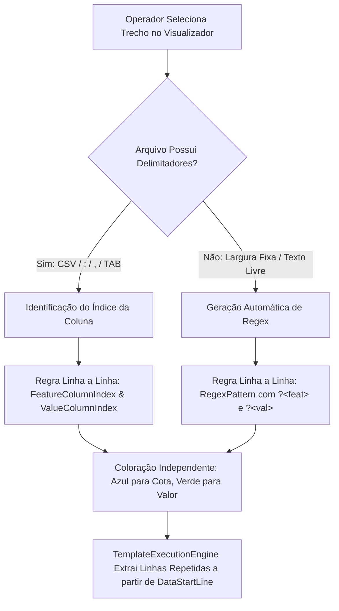

# Proposta de Arquitetura Técnica: Mapeamento Granular de Trechos/Colunas e REGEX em Formato Linha por Linha

> **Versão de Referência:** SelectML v1.2.8  
> **Módulo:** Motor de Templates para Leitor de Arquivos de Texto (Item 3)  
> **Status:** Proposta de Arquitetura & Documentação de Engenharia  
> **Documento Relacionado:** [ip-p3_template-engine.md](file:///c:/Antigravity/SelectML/docs/implementations/v1.2.8/ip-p3_template-engine.md), [sp-p3_template-engine-sprints.md](file:///c:/Antigravity/SelectML/docs/implementations/v1.2.8/sp-p3_template-engine-sprints.md)

---

## 1. Contexto e Motivação Industrial

No processamento de arquivos de medição provenientes de equipamentos industriais (ex.: projetores de perfil, micrômetros digitais contínuos, medidores de rugosidade, braços de medição e CMMs), é frequente encontrar arquivos de dados estruturados em **formato vertical (linha por linha)** onde cada linha carrega **mais do que apenas o par simples `<Cota>;<Valor>`**.

### Cenário Comum de Entrada:
```text
Data;Hora;Nome da Característica;Tol Superior;Tol Inferior;Valor Medido;Status;Operador
2026-10-12;14:30;MICL Ø2.32;2.3500;2.3000;2.3210;APROVADO;OP12
2026-10-12;14:30;Ângulo 45°;45.50;44.50;45.0200;APROVADO;OP12
2026-10-12;14:30;Rugosidade Ra;1.5000;0.5000;1.1800;APROVADO;OP12
```

### O Desafio da Dedução Automática "Tudo ou Nada":
Caso o usuário seja obrigado a marcar a linha inteira como `"Cota e Valor Medido (Linha por Linha)"`, o algoritmo teria que adivinhar qual das 8 colunas representa a cota e qual representa o valor medido. Como tanto a data quanto as tolerâncias podem conter números, uma heurística ingênua de "pegar o primeiro número" falharia, confundindo as tolerâncias (`2.3500`) com o valor medido real (`2.3210`).

---

## 2. Abordagem de Referência (MeasurLink Template Engine)

No editor de templates do Mitutoyo MeasurLink:
1. O usuário visualiza o arquivo de texto bruto em uma área monoespaçada.
2. Em uma linha de amostra de dados, o operador **destaca com o cursor do mouse apenas a palavra/número desejado** (ex.: seleciona `MICL Ø2.32`).
3. Clica com o botão direito e escolhe: **"Atribuir como Nome da Característica"**.
4. Em seguida, na mesma linha ou no bloco de dados, o operador seleciona `2.3210`, clica com o botão direito e escolhe: **"Atribuir como Valor Medido"**.
5. O software reconhece a posição relativa dos campos na linha:
   * **Modo Delimitado:** Identifica os índices das colunas (`Coluna 3` e `Coluna 6`).
   * **Modo Texto Livre / Fixo:** Gera automaticamente um padrão de captura Regex com grupos nomeados `(?<feat>...)` e `(?<val>...)`.

---

## 3. Modelo Arquitetural Proposto para o SelectML

Propomos estruturar essa capacidade em duas camadas complementares: **Dedução Granular por Coluna Delimitada** e **Captura Avançada por REGEX**.



### 3.1. Extensões no Modelo de Dados (`TemplateLineRule`)

A classe [TemplateLineRule](file:///c:/Antigravity/SelectML/SelectML.Core/Templates/TemplateLineRule.cs) já possui campos fundamentais preparados na Sprint 1:
```csharp
public class TemplateLineRule
{
    public int LineIndex { get; set; } = 0; // 0 = Aplica-se a todas as linhas a partir de DataStartLine
    public LineRuleRole Role { get; set; }  // RowFeatureAndValue = 5
    public string Separator { get; set; } = ";";
    
    // Índices de coluna para arquivos delimitados
    public int FeatureColumnIndex { get; set; } = 0; // Índice da coluna da cota (0-based)
    public int ValueColumnIndex { get; set; } = 1;   // Índice da coluna do valor (0-based)
    
    // Suporte a captura por Expressão Regular (REGEX)
    public string RegexPattern { get; set; } = string.Empty;
    public string RegexGroupName { get; set; } = string.Empty;
}
```

### 3.2. Novo Fluxo no Menu de Contexto do Visualizador

No editor de texto interativo da tela de configuração, o menu de contexto com botão direito será refinado:

```text
┌─────────────────────────────────────────────────────────────────┐
│ 🔴  Nome da Rotina (PartName)                                    │
│ 🟣  Nome da Corrida / Lote (BatchNumber)                         │
├─────────────────────────────────────────────────────────────────┤
│ 🔵  Nomes das Características (Linha Horizontal)                │
│ 🟢  Valores Medidos (Linha Horizontal)                           │
├─────────────────────────────────────────────────────────────────┤
│ 🔹  Característica Deste Trecho/Coluna (Linha a Linha)          │
│ 🔸  Valor Medido Deste Trecho/Coluna (Linha a Linha)            │
│ 🔶  Cota + Valor Completo (Auto-deduzir Linha Inteira)          │
├─────────────────────────────────────────────────────────────────┤
│ ✖   Remover Marcação desta Linha                                │
└─────────────────────────────────────────────────────────────────┘
```

#### Comportamento dos Comandos:
1. **Selecionar `MICL Ø2.32` e clicar em *"Característica Deste Trecho/Coluna"***:
   * O sistema localiza que `MICL Ø2.32` está entre o 2º e o 3º separador `;` -> **Coluna 2** (3ª coluna).
   * A regra de linha a linha define `FeatureColumnIndex = 2`.
   * Apenas o trecho `MICL Ø2.32` é realçado em **Azul suave** (`#61AFEF`).
2. **Selecionar `2.3210` e clicar em *"Valor Medido Deste Trecho/Coluna"***:
   * O sistema localiza que `2.3210` está entre o 5º e o 6º separador `;` -> **Coluna 5** (6ª coluna).
   * A regra de linha a linha define `ValueColumnIndex = 5`.
   * O trecho `2.3210` é realçado em **Verde suave** (`#98C379`).
3. **Na Tabela de Regras Mapeadas**:
   * A linha exibe:
     * **Linha:** `Linha 2+` (ou a linha inicial selecionada).
     * **Função / Papel:** `Cota + Valor (Linha por Linha)`.
     * **Detalhes da Extração:** `Cota: Col. 3, Valor: Col. 6 (Separador: ';')`.

---

## 4. Estratégia de Geração e Execução de REGEX

Para arquivos sem delimitador explícito (como relatórios ASCII em formato tabular de largura fixa):

### 4.1. Geração Automática do Regex
Ao selecionar o trecho da cota e o trecho do valor em uma linha como:
`FEAT: DIA_EXT_12    NOM: 12.000   MEAS: 12.0035`

O `TemplateRuleGenerator` converte as posições em um padrão de captura nomeado:
```regex
FEAT:\s*(?<feat>[A-Za-z0-9_Ø°µ\.\-]+).*?MEAS:\s*(?<val>[-+]?\d+[\.,]?\d*)
```

### 4.2. Execução Determinística no `TemplateExecutionEngine`
Durante o processamento do arquivo:
```csharp
var regex = new Regex(rule.RegexPattern, RegexOptions.Compiled);
for (int i = template.DataStartLine - 1; i < lines.Length; i++)
{
    var match = regex.Match(lines[i]);
    if (match.Success)
    {
        string featName = match.Groups["feat"].Value.Trim();
        string rawVal = match.Groups["val"].Value.Trim();
        if (double.TryParse(rawVal.Replace(',', '.'), NumberStyles.Float, CultureInfo.InvariantCulture, out double val))
        {
            results[featName] = val;
        }
    }
}
```

---

## 5. Vantagens e Próximos Passos

| Aspecto | Implementação Atual (Linha Inteira) | Implementação Proposta (Granular / REGEX) |
| :--- | :--- | :--- |
| **Linhas Simples `<Cota>;<Valor>`** | ✅ Funciona de forma automática | ✅ Continua funcionando com 1 clique |
| **Linhas com 5+ Colunas (Data, Hora, Tolerâncias)** | ⚠️ Limitado a heurística numérica | ✅ Precisão absoluta por seleção do operador |
| **Arquivos sem Delimitadores (Largura Fixa)** | ❌ Requer pré-formatação externa | ✅ Suportado via REGEX automático |
| **Feedback Visual de Cores** | Linha inteira em âmbar | Cota em Azul e Valor em Verde na mesma linha |

### Plano de Ação Recomendado:
1. **Aprovação da Arquitetura:** O usuário valida a proposta técnica deste documento.
2. **Implementação do Mapeamento Granular:**
   * Adicionar as duas novas opções no menu de contexto (`TemplateConfigWindow.xaml`).
   * Atualizar o `TemplateRuleGenerator` para atribuir individualmente `FeatureColumnIndex` e `ValueColumnIndex` conforme o token clicado.
   * Suportar coloração de múltiplos trechos com cores distintas na mesma linha no `FlowDocument`.
   * Atualizar `TemplateExecutionEngine` para extrair com base nas colunas mapeadas.
