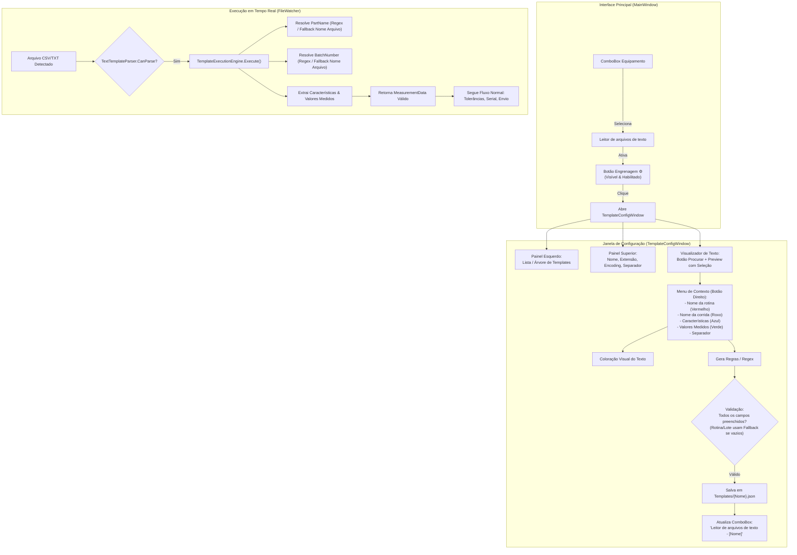

# Plano de Implementação: Mecanismo de Templates para Arquivos de Texto/CSV (V1.2.8 - Item 3)

**Versão Alvo:** 1.2.8  
**Tipo:** Nova Funcionalidade / Arquitetura de Plugins / Editor Gráfico de Templates / Parser Regex  
**Status:** Planejamento Inicial Concluído (Aguardando Alinhamento e Aprovação)  
**Data:** 12/10/2026  
**Documento de Origem:** Solicitação de Usuário (Item 3 - V1.2.8)  
**Branch de Desenvolvimento:** `feature/v1.2.8-template-engine`

---

## 1. Visão Geral e Contexto Operacional

### 1.1 Contexto e Premissa de Plugins Vivos
O **SelectML** foi projetado com uma arquitetura modular baseada em plugins dinâmicos (`IMachineParser`), permitindo a incorporação de leitores especializados para diferentes equipamentos de medição (tais como ViciVision CSV, ViciVision JSON e Zeiss Calypso PDF) apenas depositando arquivos DLL na pasta `Plugins/`.

Contudo, no chão de fábrica e em laboratórios de metrologia, é comum a existência de dezenas de instrumentos e equipamentos de medição (ex: projetores de perfil, micrômetros laser, rugosímetros, centros de usinagem e CMMs manuais) que exportam relatórios em arquivos de texto delimitados (CSV, TXT, DAT). Embora cada equipamento possua um leiaute de texto próprio, a grande maioria segue uma estrutura padrão e previsível que não justifica a criação e compilação de uma nova DLL dedicada para cada instrumento.

### 1.2 O Mecanismo de Templates (Inspiração MeasurLink)
Para suprir essa necessidade de forma flexível e autônoma, introduzimos o **Mecanismo de Templates de Texto/CSV**. Inspirado na consagrada ferramenta de *Import Templates* do Mitutoyo MeasurLink:
* A aplicação disponibiliza uma opção de algoritmo denominada **"Leitor de arquivos de texto"**, distribuída nativamente como um plugin padrão.
* Ao selecionar essa opção, o usuário visualiza um botão de configuração (ícone de engrenagem ⚙️) diretamente ao lado da caixa de seleção de equipamento.
* Ao clicar na engrenagem, abre-se a janela **"Configuração de Templates"**, onde o usuário pode gerenciar múltiplos templates e criar regras visuais de mapeamento de linhas e colunas através de um visualizador interativo de texto.
* O operador carrega um arquivo de texto de exemplo, seleciona trechos com o mouse, clica com o botão direito e atribui funções essenciais:
  1. **Nome da rotina** (`PartName` / Identificação da Peça).
  2. **Nome da corrida (lote)** (`BatchNumber` / Identificação do Lote).
  3. **Nome da característica** (nomes das cotas/dimensões).
  4. **Valor medido** (leituras numéricas correspondentes).
  5. **Separador** (delimitador de tokens: vírgula, ponto e vírgula, TAB, etc.).
* Os trechos marcados recebem destaque com **cores vivas e distintas**, enquanto expressões regulares (REGEX) e regras de separação são geradas e salvas no template.
* O template configurado e selecionado assume a operação do plugin no SelectML, permitindo que a importação de arquivos via diretório monitorado processe os dados perfeitamente no pipeline de medição, tolerâncias (Item 2) e fila serial (Item 1).

---

## 2. Requisitos Detalhados do Item 3

### Requisito 3.1: Plugin "Leitor de arquivos de texto"
* Criar o projeto de plugin `SelectML.Parsers.TextTemplate` em conformidade com o contrato `IMachineParser`.
* O plugin deve ser compilado e distribuído na pasta de plugins padrão da aplicação (`Plugins/`), vindo pré-instalado em todas as versões do SelectML.
* Nome base exibido no ComboBox: **"Leitor de arquivos de texto"** (ou `"Leitor de arquivos de texto - [NOME DO TEMPLATE]"` quando um template estiver ativo).

### Requisito 3.2: Botão de Acesso Rápido à Configuração (Engrenagem ⚙️)
* Na interface principal (`MainWindow.xaml`), na linha de seleção do Equipamento:
  * Inserir um botão estilizado com o ícone de configuração (⚙️) posicionado **à direita da ComboBox e imediatamente à esquerda do botão de exclusão ("✖")**.
  * **Visibilidade Dinâmica:** O botão deve ficar visível exclusivamente quando a opção selecionada for um leitor configurável (`SelectedParser` for o leitor de templates).
  * O botão deve respeitar `IsEnabled="{Binding IsConfigEnabled}"` (desabilitado quando o monitoramento estiver ativo).

### Requisito 3.3: Janela de "Configuração de Templates"
* Ao clicar no botão ⚙️, exibe-se a janela modal moderna com o título **"Configuração de Templates"**.
* A janela deve seguir integralmente o Design System do SelectML (Dark/Light Mode, tipografia moderna, sombras suaves, cantos arredondados, botões com feedback visual).

### Requisito 3.4: Visualização e Carregamento de Arquivos de Amostra
* A janela deve conter uma área de visualização de texto com um botão **"Procurar..."** (`Browse`).
* Ao selecionar um arquivo (CSV, TXT, DAT, etc.), o conteúdo deve ser carregado com suporte a seleção de codificação (*Encoding*: UTF-8, ANSI/Latin1 ISO-8859-1, ASCII) para garantir a leitura impecável de caracteres especiais industriais (`Ø`, `°`, `µ`).

### Requisito 3.5: Gestão de Múltiplos Templates
* A janela deve suportar a criação, renomeação, exclusão e duplicação de múltiplos templates.
* Os templates devem ser salvos em disco no formato JSON estruturado na pasta de dados da aplicação (`%APPDATA%\SelectML\Templates` ou na pasta local `Templates/`), garantindo que o usuário possa alternar entre diferentes templates rapidamente.

### Requisito 3.6: Marcação Visual Interativa, Menu de Contexto e REGEX
* O usuário seleciona trechos do texto visualizado e clica com o botão direito para abrir um menu de contexto com as opções:
  * 📋 **Nome da rotina**
  * 🏷️ **Nome da corrida (lote)**
  * 📐 **Nome da característica**
  * 📊 **Valor medido**
  * ⚙️ **Definir separador da linha / template** (vírgula `,`, ponto e vírgula `;`, TAB `\t`, espaço, etc.)
  * ❌ **Remover marcação**
* **Destaque Visual por Cores:** Cada trecho/linha marcado deve ser colorido na interface:
  * **Nome da rotina:** Vermelho / Carmesim (`#E53935` / `#FF5252`)
  * **Nome da corrida:** Roxo / Magenta (`#8E24AA` / `#AB47BC`)
  * **Nome da característica:** Azul (`#1E88E5` / `#42A5F5`)
  * **Valor medido:** Verde (`#43A047` / `#66BB6A`)
* **Geração Automática de Regras/REGEX:** A aplicação deve gerar internamente a expressão regular ou regra de tokenização para identificar e extrair cada trecho de forma determinística.

### Requisito 3.7: Validações Obrigatórias e Fallback Automático
* Para que o template possa ser salvo:
  * **Obrigatório:** Mapeamento de **Características** e **Valores Medidos** (ambos devem estar presentes e possuir mapeamento coerente de colunas/tokens).
  * **Fallback Inteligente:** Caso o usuário **não** selecione trechos para "Nome da rotina" ou "Nome da corrida", o template marcará automaticamente a flag de *Fallback* para utilizar o **Nome do arquivo processado** (sem extensão). Dessa forma, a validação de preenchimento completo é sempre atendida sem bloquear o operador.

### Requisito 3.8: Atualização do Rótulo na Tela Principal
* Ao salvar ou selecionar um template e confirmar (botão OK):
  * O ComboBox "Equipamento" na tela principal deve refletir a seleção: **"Leitor de arquivos de texto - [NOME DO TEMPLATE]"**.
  * A configuração de último plugin e template ativo deve ser persistida no `appsettings.json` para ser restaurada na próxima inicialização do sistema.

### Requisito 3.9: Execução em Tempo Real no Monitoramento
* Ao iniciar o monitoramento, os arquivos recebidos na pasta `WatchDirectory` cuja extensão corresponda ao template devem ser processados pelo `TextTemplateParser`.
* O parser extrai `PartName`, `BatchNumber` e o dicionário de `{ CharacteristicName: MeasuredValue }`, retornando um `MeasurementData` válido.
* O fluxo segue o ciclo normal de negócios do SelectML: alimentação do DataGrid, tolerâncias e atributos (Item 2), integração de medidas seriais (Item 1), geração de relatórios e gravação em banco de dados.

---

## 3. Mapeamento de Conflitos, Perguntas de Projeto e Soluções Técnicas

### ⚠️ P1: Arquitetura do Plugin vs. UI Rica WPF (Onde reside a Janela de Edição?)
* **Contexto Analisado:**
  * No SelectML, plugins são carregados dinamicamente via Reflection (`PluginLoader.cs`) a partir de `Plugins/*.dll`.
  * Se a janela de configuração (`TemplateConfigWindow`) fosse compilada dentro da DLL do plugin:
    * Haveria necessidade de duplicar recursos de tema, dicionários de cores Dark/Light mode e diálogos na DLL, gerando acoplamento desnecessário e risco de inconsistências visuais.
* **Solução Técnica Recomendada (Arquitetura Híbrida / Desacoplada):**
  * O projeto **`SelectML.Core`** define a interface `ITemplateConfigurableParser : IMachineParser` ou propriedades de extensão.
  * O projeto de plugin **`SelectML.Parsers.TextTemplate`** implementa a lógica do motor de execução (`TemplateExecutionEngine`) e implementa `IMachineParser`.
  * A janela gráfica **`TemplateConfigWindow`** e seu **`TemplateConfigViewModel`** residem no projeto **`SelectML.Client`** (assim como `SerialConfigWindow` e `NameModifierConfigWindow`), compartilhando nativamente todos os recursos visuais, serviços de diálogo (`ModernDialogWindow`) e gerenciamento de arquivos de configuração.
  * Quando o usuário clica no botão ⚙️ no `MainWindow`, o `MainViewModel` abre a `TemplateConfigWindow`, passa o template ativo e, ao fechar, atualiza o parser e a interface.

### ⚠️ P2: Comportamento Dinâmico do ComboBox "Equipamento"
* **Contexto Analisado:**
  * O ComboBox de equipamentos consome `AvailableParsers` (`ObservableCollection<IMachineParser>`) e exibe `MachineName`.
  * Na assinatura original de `IMachineParser`, `MachineName` é apenas `{ get; }` e a coleção não notificava alteração de propriedades internas.
* **Solução Técnica Recomendada:**
  * O parser `TextTemplateParser` implementará `INotifyPropertyChanged` para sua propriedade `MachineName`.
  * `MachineName` terá como base:
    * Se nenhum template selecionado: `"Leitor de arquivos de texto"`
    * Se um template estiver selecionado: `$"Leitor de arquivos de texto - {ActiveTemplate.Name}"`
  * Quando o usuário salva/seleciona um template na janela de configuração, o `TextTemplateParser` atualiza seu `ActiveTemplate` e dispara `OnPropertyChanged(nameof(MachineName))`, atualizando o ComboBox instantaneamente.
  * O `AppConfig` armazenará tanto o `LastPluginName` quanto o `LastTemplateName`, garantindo recuperação íntegra no boot.

### ⚠️ P3: Tipologia dos Arquivos de Texto (Matriz Horizontal vs. Linha por Linha)
* **Contexto Analisado:**
  * Conforme a imagem do MeasurLink anexada pelo usuário, o caso clássico industrial organiza os dados em **linhas horizontais delimitadas**:
    * Linha 1: Nome da Peça / Rotina
    * Linha 2: Nome do Lote / Corrida
    * Linha 3: Nomes das Características (delimitadas por `;`)
    * Linha 4: Leituras / Valores Medidos (delimitados por `;`)
  * No entanto, alguns equipamentos exportam dados em **linhas verticais** (uma linha por cota, ex: `DIAMETRO_1; 12.450`).
* **Solução Técnica Recomendada:**
  * Modelar a regra de extração com suporte a dois modos fundamentais:
    1. **Modo Linha Delimitada / Matriz (Padrão MeasurLink - Prioritário):** O usuário marca a linha do cabeçalho de características e a linha de leituras, definindo o separador. O sistema emparelha os tokens `Característica[i]` com `Valor[i]`.
    2. **Modo Captura por Regex / Bloco:** O usuário seleciona um trecho ou máscara REGEX com grupos nomeados `(?<feat>...)` e `(?<val>...)`.
  * A primeira entrega (Item 3) priorizará integralmente o formato da imagem de referência (Mapeamento de Linhas Delimitadas e Campos Únicos), cobrindo >95% dos arquivos CSV industriais.

### ⚠️ P4: Local de Armazenamento dos Arquivos de Template
* **Contexto Analisado:**
  * O usuário mencionou: *"ficar salvos na pasta de configuração ou plugin da aplicação do usuário"*.
  * Aplicações instaladas em `Program Files` não possuem permissão de escrita para usuários sem privilégios de Administrador.
* **Solução Técnica Recomendada:**
  * Utilizar o diretório `%APPDATA%\SelectML\Templates\` como local prioritário de leitura/escrita do usuário.
  * O sistema também verifica a pasta local `Templates\` (ao lado do executável) para templates padrão de fábrica (*Built-in Templates*), copiando-os para o AppData caso necessário.
  * Cada template será um arquivo `.json` individual (ex: `Templates\Torno_CNC.json`), facilitando backup, exportação e compartilhamento entre computadores da fábrica.

### ⚠️ P5: Tratamento de Separadores Decimais e Codificação de Caracteres
* **Contexto Analisado:**
  * Arquivos CSV podem utilizar ponto (`.`) ou vírgula (`,`) como separador decimal, dependendo do país do software da máquina de medição.
  * Caracteres especiais como `Ø` (diâmetro), `°` (ângulo) e `µ` (rugosidade) corrompem se lidos em UTF-8 quando foram gravados em ANSI/Windows-1252.
* **Solução Técnica Recomendada:**
  * Cada template armazenará sua configuração de **Encoding** (`UTF-8`, `ISO-8859-1 / Latin1`, `ASCII`, `Default`).
  * O parser utiliza `CultureInfo.InvariantCulture` com suporte resiliente para conversão de valores numéricos que contenham vírgula ou ponto (inclusive tratando delimitadores de campo com vírgula).

---

## 4. Arquitetura da Solução e Diagramas



---

## 5. Estrutura de Modelos e Modificações Previstas

### 5.1 Novos Modelos de Dados de Templates
Localização: `SelectML.Core/Templates/` (ou namespace dedicado em `SelectML.Core`)

#### `TemplateDefinition.cs`
```csharp
namespace SelectML.Core.Templates
{
    public class TemplateDefinition
    {
        public string Id { get; set; } = Guid.NewGuid().ToString();
        public string Name { get; set; } = "Novo Template";
        public string FileExtension { get; set; } = ".csv";
        public string EncodingName { get; set; } = "UTF-8"; // UTF-8, Latin1, etc.
        public string DefaultSeparator { get; set; } = ";";
        public string DecimalSeparator { get; set; } = "."; // Ponto ou Vírgula
        
        // Fallbacks automáticos
        public bool UseFileNameForPartName { get; set; } = false;
        public bool UseFileNameForBatchNumber { get; set; } = false;

        // Regras por Linha
        public List<TemplateLineRule> LineRules { get; set; } = new List<TemplateLineRule>();

        public bool IsValid(out string errorMessage)
        {
            // Valida se possui regras para Características e Valores Medidos
            // Valida consistência de separadores e fallbacks
        }
    }
}
```

#### `TemplateLineRule.cs`
```csharp
namespace SelectML.Core.Templates
{
    public enum LineRuleRole
    {
        PartName = 1,          // Nome da Rotina
        BatchNumber = 2,       // Nome da Corrida / Lote
        CharacteristicNames = 3, // Nomes das Características (delimitadas ou regex)
        MeasuredValues = 4     // Valores Medidos (delimitados ou regex)
    }

    public class TemplateLineRule
    {
        public int LineIndex { get; set; } // 1-based line number (ex: 1, 2, 3...)
        public LineRuleRole Role { get; set; }
        public string Separator { get; set; } = ";";
        public string RegexPattern { get; set; } = string.Empty;
        public int StartColumn { get; set; } = 0; // Opcional para posicional
        public int EndColumn { get; set; } = 0;
    }
}
```

### 5.2 Novo Projeto de Plugin: `SelectML.Parsers.TextTemplate`
* Localização: `SelectML.Parsers.TextTemplate/SelectML.Parsers.TextTemplate.csproj`
* Contém a classe `TextTemplateParser : IMachineParser, INotifyPropertyChanged`
* Contém `TemplateExecutionEngine.cs` que lê o arquivo utilizando a `TemplateDefinition` ativa.
* Ao compilar, gera `Plugins\SelectML.Parsers.TextTemplate.dll` automaticamente.

### 5.3 Serviço de Gerenciamento de Templates: `TemplateRepository.cs`
Localização: `SelectML.Client/Services/TemplateRepository.cs`
* `IEnumerable<TemplateDefinition> GetAllTemplates();`
* `TemplateDefinition? GetTemplateByName(string name);`
* `void SaveTemplate(TemplateDefinition template);`
* `void DeleteTemplate(string name);`
* `string GetTemplatesDirectory();`

---

## 6. Design Visual e Experiência do Usuário (UI/UX)

### 6.1 Posicionamento da Engrenagem na Tela Principal
```text
+------------------------------------------------------------------------------------+
| Equipamento:                                                                       |
| [ Leitor de arquivos de texto - Torno CNC  ▼ ] [ ⚙ ] [ ✖ ]                          |
+------------------------------------------------------------------------------------+
```
* **Botão ⚙**: Ícone sutil e elegante, no mesmo tamanho (25x30 ou 30x30) do botão "✖", com efeito hover harmônico ao design system.
* Visível somente quando o `SelectedParser` for o leitor de templates.

### 6.2 Layout da Janela "Configuração de Templates"
* Janela dimensionável (mínimo 960x650), centralizada na tela mãe.
* **Painel Esquerdo (Biblioteca de Templates):**
  * Título: "Biblioteca de Templates"
  * Barra de ferramentas: Botão Criar (➕), Duplicar (📋), Excluir (🗑️).
  * Lista/Árvore estilizada contendo todos os templates disponíveis.
* **Painel Superior Direito (Configurações do Template):**
  * Nome do Template: `[ TextBox ]`
  * Extensão do Arquivo: `[ ComboBox (.csv, .txt, .dat, todos) ]`
  * Codificação: `[ ComboBox (UTF-8, Latin-1 / ANSI, ASCII) ]`
  * Separador Padrão: `[ ComboBox (Ponto e vírgula ';', Vírgula ',', Tab, Espaço) ]`
  * Tabela resumo das regras configuradas:
    * Colunas: `Linha` | `Função` | `Separador / Padrão` | `Status`
* **Painel Inferior Direito (Visualizador Interativo de Arquivo de Amostra):**
  * Barra de carregamento: `Arquivo: [ TextBox caminho ] [ Procurar... ] [ Descarregar ]`
  * Área de Texto com fonte monoespaçada (`Consolas` / `Cascadia Code`), numeração de linhas lateral e barra de rolagem sincronizada.
  * Suporte a seleção de trecho e clique com o botão direito para aplicar as cores e regras:
    * 🔴 **Nome da rotina** (Fundo avermelhado suave / Borda)
    * 🟣 **Nome da corrida** (Fundo roxo suave / Borda)
    * 🔵 **Características** (Fundo azul suave / Borda)
    * 🟢 **Valores Medidos** (Fundo verde suave / Borda)
* **Rodapé da Janela:**
  * Indicador de validação: Ícone de status (verde quando válido, amarelo com orientações quando faltar campos).
  * Botões de ação: `[ Cancelar ]` e `[ Salvar e Aplicar ]` (Primary Action Button).

---

## 7. Estratégia de Testes e Homologação

1. **Testes de Carregamento e Codificação:**
   * Arquivo UTF-8 e arquivo Latin1 contendo símbolos de engenharia (`Ø 12.5`, `30° 15'`, `µm`).
2. **Testes de Geração de Regras e Regex:**
   * Marcação de linhas delimitadas por ponto e vírgula `;`.
   * Validação da captura fiel de características e leituras correspondentes.
3. **Testes de Fallback:**
   * Template sem marcação de Rotina e Corrida -> Verificação se o nome do arquivo foi utilizado com sucesso para ambos.
4. **Testes de Bloqueio de Validação:**
   * Tentativa de salvar sem marcar Características ou sem marcar Valores Medidos -> Janela exibe mensagem clara sem crash.
5. **Testes de Integração e Monitoramento:**
   * Iniciar o monitoramento com o template ativo;
   * Copiar arquivo de amostra na pasta de entrada;
   * Confirmar que o arquivo é lido, preenche o grid, valida tolerâncias (Item 2) e pode ser enviado para a base MeasurLink com perfeição.
