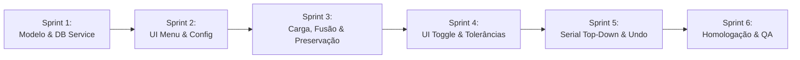

# Planejamento de Sprints: Listagem e Validação de Características (V1.2.8 - Item 2)

**Versão Alvo:** 1.2.8  
**Tipo:** Sprint Planning / Roteiro de Execução Técnica  
**Status:** Revisado e Pronto para Execução  
**Data:** 10/10/2026  
**Documento Técnico de Referência:** [ip-p2_feature-listing.md](file:///c:/Antigravity/SelectML/docs/implementations/v1.2.8/ip-p2_feature-listing.md)  
**Branch de Desenvolvimento:** `feature/v1.2.8-feature-listing`

---

## 1. Estratégia de Desenvolvimento

Para garantir estabilidade contínua, zero regressões no processamento legado e permitir validação e testes incrementais a cada etapa, a implementação do **Item 2 da V1.2.8** está estruturada em **6 Sprints modulares**:

Cada sprint possui escopo bem delimitado, tarefas técnicas com caixas de seleção, arquivos afetados e critérios de aceitação objetivos.

---

## 2. Detalhamento das Sprints

### 🏁 Sprint 1: Modelo de Dados e Consulta Otimizada no Banco de Dados
> **Objetivo:** Criar os modelos de representação de características de rotina (`InspectionFeatureInfo`) e implementar a consulta SQL otimizada no `DatabaseService` resolvendo o lote internamente via `RunName`.

* **Arquivos Afetados:**
  * `SelectML.Core/InspectionFeatureInfo.cs` (Novo arquivo)
  * `SelectML.Core/IDatabaseService.cs`
  * `SelectML.Client/Services/DatabaseService.cs`
  * `SelectML.Client/Services/AppConfig.cs`
* **Tarefas Técnicas:**
  - [x] Criar a classe `InspectionFeatureInfo` em `SelectML.Core` contendo:
    - `OrderNo`, `FeatureID`, `FeatureName`, `FeatureType`, `TipoDescricao`, `Nominal`, `LSL`, `USL`, `DecimalLength` e propriedade booleana `IsAttribute`.
  - [x] Adicionar à `AppConfig.cs` a propriedade `public bool ListAllFeatures { get; set; } = false;`.
  - [x] Atualizar `IDatabaseService.cs` com a assinatura:
    - `Task<List<InspectionFeatureInfo>> GetInspectionRoutineFeaturesAsync(string runName);`
  - [x] Implementar em `DatabaseService.cs` a consulta otimizada `GetInspectionRoutineFeaturesAsync` utilizando `WITH (NOLOCK)` em `FeatureRun`, `Feature` e `FeatureProperties`, ordenando nativamente por `fr.OrderNo ASC`, com resolução interna do `@TargetRunID` por `@RunName` em `ActiveRun` e `Run`.
* **Critério de Aceitação:**
  * Teste unitário/integrado executando contra a base local `MeasurLink10` para `RunName = '067931-102026'` retorna a listagem completa na ordem correta em menos de 30ms. [Validado com êxito: 14 ms em média]

---

### 🎨 Sprint 2: Interface Gráfica do Menu "Configuração" e Persistência
> **Objetivo:** Adicionar o menu "Configuração" na barra superior ao lado direito de "Modificador de nomes", com sub-item checkable "Listar todas as características" e persistência da configuração.

* **Arquivos Afetados:**
  * `SelectML.Client/MainWindow.xaml`
  * `SelectML.Client/ViewModels/MainViewModel.cs`
* **Tarefas Técnicas:**
  - [x] Em `MainViewModel.cs`:
    - [x] Adicionar propriedade bindável `IsListAllFeaturesActive` com notificação de alteração.
    - [x] Carregar o valor inicial a partir de `config.ListAllFeatures` no construtor.
    - [x] Salvar o valor no `appsettings.json` através do `_configService` ao alterar a opção.
  - [x] Em `MainWindow.xaml`:
    - [x] Inserir um novo `MenuItem` imediatamente à direita do menu *"Modificador de nomes"*:
      - Cabeçalho: *"Configuração"* (sem círculo pulsante).
      - Sub-item: *"Listar todas as características"* com `IsCheckable="True"` e binding bidirecional com `IsListAllFeaturesActive`.
* **Critério de Aceitação:**
  * O menu "Configuração" aparece alinhado na barra superior com o mesmo estilo visual e tipografia dos menus vizinhos.
  * Ao clicar para marcar/desmarcar a opção, o estado é atualizado instantaneamente.
  * Ao fechar e reabrir o aplicativo, o estado selecionado é restaurado com perfeição a partir de `appsettings.json`. [Validado com êxito via teste automatizado e build com 0 erros]

---

### ⚙️ Sprint 3: Ciclo de Processamento, Fusão e Preservação de Valores
> **Objetivo:** Integrar a busca da rotina completa durante a carga de arquivos e digitação manual do lote, mantendo exclusão de linhas opcional e preservando valores medidos na alteração do lote.

* **Arquivos Afetados:**
  * `SelectML.Client/ResultItem.cs`
  * `SelectML.Client/ViewModels/MainViewModel.cs`
* **Tarefas Técnicas:**
  - [ ] Atualizar `ResultItem.cs` para suportar:
    - `double? Value` (nullable), flag `HasValue`, `FeatureType`, `IsAttribute`, `IsApproved`, `Nominal`, `LSL`, `USL`, `DecimalLength`, `IsFromDbRoutine`.
  - [ ] No `MainViewModel.cs` (método de carga de arquivo `OnFileCreated` / `ProcessFile`):
    - [ ] Se `IsListAllFeaturesActive == true`:
      - [ ] Obter o identificador do lote (`data.BatchNumber`).
      - [ ] Consultar a rotina via `GetInspectionRoutineFeaturesAsync(data.BatchNumber)`.
      - [ ] Se houver cotas na rotina:
        - Mesclagem na ordem `fr.OrderNo ASC`:
          - Cota presente no arquivo: atribui o valor medido e define `HasValue = true`.
          - Cota ausente no arquivo: insere com `HasValue = false` (aguardando medição com placeholder).
          - Define `IsFromDbRoutine = true`.
        - Anexa eventuais cotas do arquivo ausentes na rotina do banco no rodapé.
    - [ ] No método `DetectStationAndFeatures()` (digitação manual do lote no cabeçalho):
      - [ ] Se `IsListAllFeaturesActive == true`:
        - Capturar os valores previamente digitados/medidos na tela (`var previousValues = MeasuredResults.Where(x => x.HasValue).ToDictionary(...)`).
        - Carregar a rotina do novo lote via `GetInspectionRoutineFeaturesAsync(BatchNumber)`.
        - **Preservação de Valores:** Para cada cota da nova lista que já possuía valor medido na tela anterior, restaurar o valor automaticamente, evitando retrabalho.
    - [ ] Assegurar que a exclusão manual de linha (botão direito -> *"Excluir valor"*) continue funcionando para o operador descartar cotas não desejadas.
    - [ ] Ajustar `IsAutoMode`: suspender o auto-envio caso `IsListAllFeaturesActive == true` e restem cotas pendentes na rotina.
* **Critério de Aceitação:**
  * Ao carregar arquivo com 3 cotas para uma rotina de 15 cotas, a tela exibe todas as 15 cotas na ordem sequencial do MeasurLink.
  * As 3 cotas do arquivo exibem seus valores; as outras 12 exibem o indicativo *"Aguardando medição..."*.
  * Ao alterar o número do lote no cabeçalho, a rotina é atualizada e os valores já digitados nas cotas coincidentes permanecem preservados.

---

### 🎛️ Sprint 4: Customização da Coluna Valor: Toggle de Atributos, Watermark e Cores
> **Objetivo:** Implementar o controle toggle "Aprovado/Reprovado" para Atributos, o placeholder de digitação para Variáveis e a coloração visual baseada em tolerâncias.

* **Arquivos Afetados:**
  * `SelectML.Client/ResultItem.cs`
  * `SelectML.Client/MainWindow.xaml`
  * `SelectML.Client/ViewModels/MainViewModel.cs`
* **Tarefas Técnicas:**
  - [ ] Em `ResultItem.cs`:
    - [ ] Implementar a lógica de cálculo de `ToleranceStatus` (`Conforming`, `OutOfTolerance`, `Pending`, `NotEvaluated`).
    - [ ] Para características do tipo Variável com valor:
      - Se `LSL` e `USL` definidos: `Value >= LSL && Value <= USL` -> Conforming (Verde); caso contrário, OutOfTolerance (Vermelho).
      - Tratamento para limites unilaterais (apenas USL ou apenas LSL).
      - Sem tolerâncias cadastradas: `NotEvaluated` (cor neutra padrão).
    - [ ] Para características do tipo Atributo:
      - Se `IsApproved == true` -> Conforming (Verde); se `false` -> OutOfTolerance (Vermelho).
  - [ ] Em `MainWindow.xaml`:
    - [ ] Estilizar a coluna *"Valor"* no `ResultsDataGrid`:
      - **Para Atributos (`IsAttribute == true`):** Botão Toggle horizontal sutil e moderno (estilo pill switch) alternando entre *"Aprovado"* (verde) e *"Reprovado"* (vermelho) com um clique, sem caixa de texto numérica.
      - **Para Variáveis (`IsAttribute == false`):** TextBox com comportamento de watermark:
        - Quando `HasValue == false`: exibe texto indicativo *"Aguardando medição..."* em cinza/itálico.
        - Ao clicar/focar para digitação: o texto desaparece permitindo inserção numérica livre.
        - Cor do texto vinculada ao status de tolerância (Verde para dentro dos limites, Vermelho para fora).
  - [ ] Na rotina de envio (`GenerateOutputCsv`):
    - [ ] Para itens do tipo Atributo, gravar no CSV `0` para Aprovado e `1` para Reprovado.
* **Critério de Aceitação:**
  * Linhas de atributo exibem o botão toggle em vez de TextBox, alternando entre Aprovado e Reprovado.
  * Linhas de variáveis vazias exibem *"Aguardando medição..."*, que desaparece ao focar para digitação.
  * Valores medidos dentro da tolerância aparecem em verde; valores fora da tolerância aparecem em vermelho.
  * O arquivo CSV final exporta `0` ou `1` para os atributos e os valores decimais para as variáveis.

---

### 🔌 Sprint 5: Orquestração Serial: Preenchimento Top-Down e Desfazer Inteligente
> **Objetivo:** Direcionar as medições seriais para preencher as cotas pendentes da rotina de cima para baixo e configurar o comando Desfazer para limpar valores medidos sem deletar linhas do banco.

* **Arquivos Afetados:**
  * `SelectML.Client/ViewModels/MainViewModel.cs`
* **Tarefas Técnicas:**
  - [ ] No método `OnSerialMeasurementReceived`:
    - [ ] Se `IsListAllFeaturesActive == true`:
      - [ ] Procurar o primeiro `ResultItem` na lista que atenda a:
        `item.IsFromDbRoutine && !item.IsAttribute && !item.HasValue`.
      - [ ] Se encontrado:
        - Atribuir o valor medido: `item.Value = e.Value;`, `item.HasValue = true;`, `item.IsFromSerial = true;`.
        - Atualizar status de tolerância e disparar revalidação.
      - [ ] Se **todas** as cotas da rotina já estiverem preenchidas (ou se a funcionalidade estiver desligada):
        - Anexar como cota adicional no final da tabela (comportamento herdado da Fase 1).
  - [ ] No método `ExecuteSerialUndo`:
    - [ ] 1º Passo: Verificar se há cotas seriais adicionais (`!item.IsFromDbRoutine && item.IsFromSerial`).
      - Se houver, remover a última linha adicional da tabela (exclusão total).
    - [ ] 2º Passo: Se não houver cotas adicionais, mas houver cotas da rotina preenchidas por serial (`item.IsFromDbRoutine && item.IsFromSerial && item.HasValue`):
      - Localizar o item mais recente preenchido via serial.
      - **Limpar apenas a medição:** `item.Value = null;`, `item.HasValue = false;`, `item.IsFromSerial = false;`.
      - **Não remover a linha da tabela.** A característica permanece visível com o indicativo *"Aguardando medição..."*.
* **Critério de Aceitação:**
  * Ao receber medições seriais consecutivas, as cotas vazias da rotina são preenchidas ordenadamente de cima para baixo.
  * Ao disparar o comando Desfazer (U-WAVE ou manual), a última cota da rotina preenchida tem seu valor apagado e retorna a *"Aguardando medição..."*, mantendo sua linha intacta na tabela.
  * Cotas adicionais (além da rotina) continuam sendo excluídas normalmente pelo comando Desfazer.

---

### 🧪 Sprint 6: Testes Integrados, Homologação e QA
> **Objetivo:** Execução completa dos cenários de validação integrada, verificação contra o banco de dados `MeasurLink10` e testes de não-regressão.

* **Arquivos Afetados:**
  * `docs/implementations/v1.2.8/sp-p2_feature-listing-sprints.md` (Checklist final)
* **Tarefas Técnicas:**
  - [ ] Validação do Cenário 1: Ativação e persistência do menu "Configuração".
  - [ ] Validação do Cenário 2: Processamento de arquivo de texto com rotina completa do banco.
  - [ ] Validação do Cenário 3: Interação com botões toggle de atributos (Aprovado/Reprovado) e exportação `0`/`1`.
  - [ ] Validação do Cenário 4: Inspeção visual de limites de tolerância (Verde/Vermelho).
  - [ ] Validação do Cenário 5: Preenchimento serial sequencial top-down.
  - [ ] Validação do Cenário 6: Comando desfazer U-WAVE preservando linhas do banco com reset de valor.
  - [ ] Validação do Cenário 7: Exclusão manual de linha via botão direito e preservação de dados na alteração de lote.
  - [ ] Validação de Não-Regressão: Modo legado (`ListAllFeatures == false`) operando rigorosamente como na versão 1.2.8 Fase 1.
* **Critério de Aceitação:**
  * Todos os cenários homologados com 100% de sucesso sem falhas, erros de compilação ou exceções não tratadas no log.
