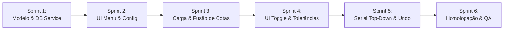

# Planejamento de Sprints: Listagem e Validação de Características (V1.2.8 - Item 2)

**Versão Alvo:** 1.2.8  
**Tipo:** Sprint Planning / Roteiro de Execução Técnica  
**Status:** Pronto para Execução (Aguardando Sinal Verde)  
**Data:** 10/10/2026  
**Documento Técnico de Referência:** [ip-p2_feature-listing.md](file:///c:/Antigravity/SelectML/docs/implementations/v1.2.8/ip-p2_feature-listing.md)  
**Branch de Desenvolvimento:** `feature/v1.2.8-feature-listing`

---

## 1. Estratégia de Desenvolvimento

Para garantir estabilidade contínua, zero regressões no processamento legado e permitir validação e testes incrementais a cada etapa, a implementação do **Item 2 da V1.2.8** está estruturada em **6 Sprints modulares**:

Cada sprint possui escopo bem delimitado, tarefas técnicas com caixas de seleção, arquivos afetados e critérios de aceitação objetivos.

---

## 2. Detalhamento das Sprints

### 🏁 Sprint 1: Modelo de Dados e Consulta Otimizada no Banco de Dados
> **Objetivo:** Criar os modelos de representação de características de rotina (`InspectionFeatureInfo`), implementar o resolvedor de RunID e a consulta SQL otimizada no `DatabaseService`.

* **Arquivos Afetados:**
  * `SelectML.Core/InspectionFeatureInfo.cs` (Novo arquivo)
  * `SelectML.Core/IDatabaseService.cs`
  * `SelectML.Client/Services/DatabaseService.cs`
  * `SelectML.Client/Services/AppConfig.cs`
* **Tarefas Técnicas:**
  - [ ] Criar a classe `InspectionFeatureInfo` em `SelectML.Core` contendo:
    - `OrderNo`, `FeatureID`, `FeatureName`, `FeatureType`, `TipoDescricao`, `Nominal`, `LSL`, `USL`, `DecimalLength` e propriedade booleana `IsAttribute`.
  - [ ] Adicionar à `AppConfig.cs` a propriedade `public bool ListAllFeatures { get; set; } = false;`.
  - [ ] Atualizar `IDatabaseService.cs` com as novas assinaturas:
    - `Task<int?> ResolveRunIdAsync(string batchOrRunIdentifier);`
    - `Task<List<InspectionFeatureInfo>> GetInspectionRoutineFeaturesAsync(int runId);`
  - [ ] Implementar em `DatabaseService.cs` o método `ResolveRunIdAsync`:
    - Tratamento com fallback: verifica se o identificador é numérico para buscar por `RunID`; caso contrário, busca por `RunName` nas tabelas `ActiveRun` e `Run` com `WITH (NOLOCK)`.
  - [ ] Implementar em `DatabaseService.cs` a consulta otimizada `GetInspectionRoutineFeaturesAsync` utilizando `WITH (NOLOCK)` em `FeatureRun`, `Feature` e `FeatureProperties`, ordenada por `fr.OrderNo ASC`.
* **Critério de Aceitação:**
  * Teste unitário/integrado executando contra a base local `MeasurLink10` para `RunID = 705` e `704` retorna a listagem completa na ordem correta em menos de 30ms.
  * O método `ResolveRunIdAsync` localiza o ID 705 tanto passando `"705"` quanto `"067931-102026"`.

---

### 🎨 Sprint 2: Interface Gráfica do Menu Superior e Persistência
> **Objetivo:** Adicionar o menu "Rotina de inspeção" na barra superior ao lado de "Modificador de nomes", com indicador de status pulsante e persistência da configuração.

* **Arquivos Afetados:**
  * `SelectML.Client/MainWindow.xaml`
  * `SelectML.Client/ViewModels/MainViewModel.cs`
* **Tarefas Técnicas:**
  - [ ] Em `MainViewModel.cs`:
    - [ ] Adicionar propriedade bindável `IsListAllFeaturesActive` com notificação de alteração.
    - [ ] Carregar o valor inicial a partir de `config.ListAllFeatures` no construtor.
    - [ ] Salvar o valor no `appsettings.json` através do `_configService` ao alterar a opção.
  - [ ] Em `MainWindow.xaml`:
    - [ ] Inserir um novo `MenuItem` imediatamente à direita do menu *"Modificador de nomes"*:
      - Cabeçalho: *"Rotina de inspeção"* com `Ellipse` de status pulsante quando ativo (`IsListAllFeaturesActive == true`).
      - Sub-item: *"Listar todas as características"* com `IsCheckable="True"` e binding bidirecional com `IsListAllFeaturesActive`.
* **Critério de Aceitação:**
  * O menu aparece alinhado na barra superior com o mesmo estilo visual e tipografia dos menus vizinhos.
  * Ao clicar para marcar/desmarcar a opção, o indicador verde reflete imediatamente o estado.
  * Ao fechar e reabrir o aplicativo, o estado selecionado é restaurado com perfeição.

---

### ⚙️ Sprint 3: Ciclo de Processamento, Resolução e Fusão de Características
> **Objetivo:** Integrar a busca da rotina completa durante o carregamento de arquivos de medição e digitação manual do lote, fundindo os dados na ordem do banco sem duplicidade.

* **Arquivos Afetados:**
  * `SelectML.Client/ResultItem.cs`
  * `SelectML.Client/ViewModels/MainViewModel.cs`
* **Tarefas Técnicas:**
  - [ ] Atualizar `ResultItem.cs` para suportar:
    - `double? Value` (ou flag `HasValue`), `FeatureType`, `IsAttribute`, `IsApproved`, `Nominal`, `LSL`, `USL`, `DecimalLength`, `IsFromDbRoutine`.
  - [ ] No `MainViewModel.cs` (método de carga de arquivo `OnFileCreated` / `ProcessFile`):
    - [ ] Se `IsListAllFeaturesActive == true`:
      - [ ] Obter o identificador do lote (`data.BatchNumber`).
      - [ ] Chamar `ResolveRunIdAsync(data.BatchNumber)`.
      - [ ] Se o lote for localizado no banco, carregar as cotas da rotina via `GetInspectionRoutineFeaturesAsync(runId)`.
      - [ ] Mesclagem na ordem `fr.OrderNo ASC`:
        - Se a cota constar no arquivo lido (comparando nome original ou formatado), atribuir o valor medido e marcar `HasValue = true`.
        - Se a cota não constar no arquivo, adicionar à tabela com seu nome e limites, com `HasValue = false` (aguardando entrada manual ou serial).
        - Atribuir `IsFromDbRoutine = true`.
      - [ ] Adicionar no final da lista eventuais cotas do arquivo que não foram encontradas na rotina do banco.
    - [ ] No método `DetectStationAndFeatures()` (digitação manual de lote):
      - [ ] Aplicar a mesma lógica de carregamento caso `IsListAllFeaturesActive == true`.
    - [ ] Ajustar `IsAutoMode`: suspender o envio automático caso `IsListAllFeaturesActive == true` e restem cotas pendentes de medição.
* **Critério de Aceitação:**
  * Ao carregar arquivo de teste com 3 cotas para uma rotina de 15 cotas, a tela exibe todas as 15 cotas na ordem sequencial do MeasurLink.
  * As 3 cotas do arquivo exibem seus respectivos valores; as outras 12 permanecem na tela aguardando medição.
  * Não há repetição de linhas.

---

### 🎛️ Sprint 4: Customização da Coluna Valor: Toggle de Atributos e Cores por Tolerância
> **Objetivo:** Implementar o controle toggle "Aprovado/Reprovado" para Atributos e a coloração visual baseada em tolerâncias (Verde para dentro dos limites, Vermelho para fora).

* **Arquivos Afetados:**
  * `SelectML.Client/ResultItem.cs`
  * `SelectML.Client/MainWindow.xaml`
  * `SelectML.Client/Selectors/ValueColumnTemplateSelector.cs` (Novo ou DataTemplate equivalente)
* **Tarefas Técnicas:**
  - [ ] Em `ResultItem.cs`:
    - [ ] Implementar a lógica de cálculo de `ToleranceStatus` (`Conforming`, `OutOfTolerance`, `Pending`, `NotEvaluated`).
    - [ ] Para características do tipo Variável com valor:
      - Se `LSL` e `USL` definidos: `Value >= LSL && Value <= USL` -> Conforming (Verde); caso contrário, OutOfTolerance (Vermelho).
      - Tratamento para limites unilaterais (apenas USL ou apenas LSL).
      - Sem tolerâncias: `NotEvaluated` (cor neutra padrão).
    - [ ] Para características do tipo Atributo:
      - Se `IsApproved == true` -> Conforming (Verde); se `false` -> OutOfTolerance (Vermelho).
  - [ ] Em `MainWindow.xaml`:
    - [ ] Criar o DataTemplate / Seletor para a coluna *"Valor"* no `ResultsDataGrid`:
      - **Para Atributos (`IsAttribute == true`):** Botão Toggle horizontal sutil e moderno (estilo pill switch) alternando entre *"Aprovado"* (verde) e *"Reprovado"* (vermelho) com um único clique.
      - **Para Variáveis (`IsAttribute == false`):** Exibição do valor formatado conforme `DecimalLength` (ou caixa de edição quando aguardando valor), com binding de cor de texto para Verde/Vermelho conforme o status de tolerância.
  - [ ] Na rotina de envio (`GenerateOutputCsv`):
    - [ ] Para itens do tipo Atributo, gravar o valor correspondente no CSV (`0.0` para Aprovado, `1.0` para Reprovado).
* **Critério de Aceitação:**
  * Linhas de atributo exibem o botão toggle em vez de TextBox, alternando entre Aprovado e Reprovado ao clique.
  * Valores medidos dentro da tolerância aparecem em verde; valores fora da tolerância aparecem em vermelho.
  * Cotas aguardando valor mantêm aparência neutra, sem disparar falso positivo de erro.

---

### 🔌 Sprint 5: Orquestração Serial: Preenchimento Top-Down e Desfazer Inteligente
> **Objetivo:** Direcionar as medições seriais para preencher as cotas pendentes da rotina de cima para baixo e configurar o comando Desfazer para limpar valores medidos sem deletar linhas do banco.

* **Arquivos Afetados:**
  * `SelectML.Client/ViewModels/MainViewModel.cs`
* **Tarefas Técnicas:**
  - [ ] No método `OnSerialMeasurementReceived`:
    - [ ] Se `IsListAllFeaturesActive == true`:
      - [ ] Procurar o primeiro `ResultItem` na lista que atenda a:
        `item.IsFromDbRoutine && !item.IsAttribute && !item.HasValue`.
      - [ ] Se encontrado:
        - Atribuir o valor medido: `item.Value = e.Value;`, `item.HasValue = true;`, `item.IsFromSerial = true;`.
        - Disparar atualização de tolerância e revalidar.
      - [ ] Se **todas** as cotas da rotina já estiverem preenchidas (ou se a funcionalidade estiver desligada):
        - Anexar como cota adicional no final da tabela (comportamento herdado da Fase 1).
  - [ ] No método `ExecuteSerialUndo`:
    - [ ] 1º Passo: Verificar se há cotas seriais adicionais (`!item.IsFromDbRoutine && item.IsFromSerial`).
      - Se houver, remover a última linha adicional da tabela (exclusão total).
    - [ ] 2º Passo: Se não houver cotas adicionais, mas houver cotas da rotina preenchidas por serial (`item.IsFromDbRoutine && item.IsFromSerial && item.HasValue`):
      - Localizar o item mais recente preenchido via serial.
      - **Limpar apenas a medição:** `item.Value = null;`, `item.HasValue = false;`, `item.IsFromSerial = false;`.
      - **Não remover a linha da tabela.** A característica permanece visível aguardando nova medição.
* **Critério de Aceitação:**
  * Ao receber medições seriais consecutivas, as cotas vazias da rotina são preenchidas ordenadamente de cima para baixo.
  * Ao disparar o comando Desfazer (U-WAVE ou manual), a última cota da rotina preenchida tem seu valor apagado, mas sua linha permanece intacta na tabela.
  * Cotas adicionais (além da rotina) continuam sendo excluídas normalmente pelo comando Desfazer.

---

### 🧪 Sprint 6: Testes Integrados, Homologação e QA
> **Objetivo:** Execução completa dos cenários de validação integrada, verificação contra o banco de dados `MeasurLink10` e testes de não-regressão.

* **Arquivos Afetados:**
  * `docs/implementations/v1.2.8/sp-p2_feature-listing-sprints.md` (Checklist final)
* **Tarefas Técnicas:**
  - [ ] Validação do Cenário 1: Ativação, desativação e persistência em `appsettings.json`.
  - [ ] Validação do Cenário 2: Processamento de arquivo de texto com lote contendo rotina no banco.
  - [ ] Validação do Cenário 3: Interação com botões toggle de atributos (Aprovado/Reprovado).
  - [ ] Validação do Cenário 4: Inspeção visual de limites de tolerância (Verde/Vermelho).
  - [ ] Validação do Cenário 5: Preenchimento serial sequencial top-down.
  - [ ] Validação do Cenário 6: Comando desfazer U-WAVE preservando linhas do banco.
  - [ ] Validação do Cenário 7: Geração e conformidade do arquivo CSV final de saída (`SELECTML.itpl`).
  - [ ] Validação de Não-Regressão: Modo legado (`ListAllFeatures == false`) operando rigorosamente como na versão 1.2.8 Fase 1.
* **Critério de Aceitação:**
  * Todos os 7 cenários homologados com 100% de sucesso sem falhas, erros de compilação ou exceções não tratadas no log.
