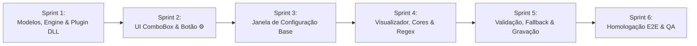

# Planejamento de Sprints: Mecanismo de Templates para Arquivos de Texto/CSV (V1.2.8 - Item 3)

**Versão Alvo:** 1.2.8  
**Tipo:** Sprint Planning / Roteiro de Execução Técnica  
**Status:** Planejamento Refinado e Alinhado (Aguardando Aval Final para Execução)  
**Data:** 13/10/2026  
**Documento Técnico de Referência:** [ip-p3_template-engine.md](file:///c:/Antigravity/SelectML/docs/implementations/v1.2.8/ip-p3_template-engine.md)  
**Branch de Desenvolvimento:** `feature/v1.2.8-template-engine`

---

## 1. Estratégia de Desenvolvimento

Para viabilizar a entrega progressiva com máxima otimização de código, testes de isolamento a cada etapa e risco nulo de regressão, a implementação do **Mecanismo de Templates (Item 3 da V1.2.8)** está estruturada em **6 Sprints modulares**:

Cada sprint possui escopo delimitado, tarefas rastreáveis por checklist, arquivos afetados e critérios de aceitação objetivos.

---

## 2. Detalhamento das Sprints

### 🏁 Sprint 1: Modelos de Template, Motor de Execução e Plugin DLL Enxuto
> **Objetivo:** Criar os modelos de dados enxutos em `SelectML.Core`, implementar a biblioteca de classes do novo plugin `SelectML.Parsers.TextTemplate` que implementa `IMachineParser`, desenvolver o motor de extração resiliente com auto-detecção de encoding (UTF-8/Latin-1), suporte a leiaute horizontal e linha por linha, conversão decimal inteligente e o repositório centralizado em `%APPDATA%\SelectML\Templates`.

* **Arquivos Afetados:**
  * `SelectML.Core/Templates/TemplateDefinition.cs` (Novo arquivo)
  * `SelectML.Core/Templates/TemplateLineRule.cs` (Novo arquivo)
  * `SelectML.Core/IConfigurableParser.cs` (Novo arquivo)
  * `SelectML.Parsers.TextTemplate/SelectML.Parsers.TextTemplate.csproj` (Novo projeto)
  * `SelectML.Parsers.TextTemplate/TextTemplateParser.cs` (Novo arquivo)
  * `SelectML.Parsers.TextTemplate/TemplateExecutionEngine.cs` (Novo arquivo)
  * `SelectML.Parsers.TextTemplate/EncodingDetector.cs` (Novo arquivo)
  * `SelectML.Client/Services/TemplateRepository.cs` (Novo arquivo)
  * `SelectML.sln` (Inclusão do novo projeto)
* **Tarefas Técnicas:**
  - [x] Criar a estrutura de modelos `TemplateDefinition` e `TemplateLineRule` em `SelectML.Core.Templates`.
  - [x] Criar a interface `IConfigurableParser : IMachineParser` para identificação de parsers parametrizáveis.
  - [x] Criar o projeto de biblioteca de classes `.NET 8` `SelectML.Parsers.TextTemplate` com saída configurada para `..\SelectML.Client\bin\$(Configuration)\net8.0-windows\Plugins\`.
  - [x] Implementar `EncodingDetector`: identificação automática transparente de UTF-8 (com/sem BOM) e ISO-8859-1 (Latin-1/ANSI).
  - [x] Implementar `TemplateExecutionEngine`:
    - Leitura com codificação auto-detectada.
    - Suporte a extração de `PartName` e `BatchNumber` (via regra ou fallback automático de nome de arquivo).
    - Suporte unificado e transparente a **leiaute horizontal** (linha de cotas + linha de valores) e **leiaute linha a linha** (cada linha com cota + valor).
    - Conversão decimal inteligente (reconhecimento automático de ponto ou vírgula como separador decimal).
  - [x] Implementar `TextTemplateParser : IConfigurableParser, INotifyPropertyChanged` com suporte a template ativo e nome dinâmico.
  - [x] Implementar `TemplateRepository` em `SelectML.Core.Templates` salvando em `%APPDATA%\SelectML\Templates`.
* **Critério de Aceitação:**
  * O projeto compila com sucesso, gera `Plugins\SelectML.Parsers.TextTemplate.dll` e um teste unitário executa o parsing de arquivos horizontais e linha por linha contendo caracteres especiais (`Ø`, `°`, `µ`) e vírgula decimal, retornando `MeasurementData` perfeito. [100% Validado com êxito na suíte automatizada]

---

### 🎨 Sprint 2: Integração com a Tela Principal (`MainWindow`) e ComboBox "Equipamento"
> **Objetivo:** Integrar o leitor de templates à tela principal, exibir o botão de engrenagem ⚙️ condicionalmente quando o leitor estiver selecionado, atualizar dinamicamente o texto da ComboBox para refletir o template ativo e persistir as escolhas no `appsettings.json`.

* **Arquivos Afetados:**
  * `SelectML.Client/MainWindow.xaml`
  * `SelectML.Client/ViewModels/MainViewModel.cs`
  * `SelectML.Client/Services/AppConfig.cs`
* **Tarefas Técnicas:**
  - [x] Em `AppConfig.cs`:
    - Adicionar a propriedade `public string LastTemplateName { get; set; } = string.Empty;`.
  - [x] Em `MainWindow.xaml`:
    - No `Grid` da seção "Equipamento", adicionar coluna intermediária para o botão de configuração:
      - Botão com ícone ⚙️, estilo `IconButton`, posicionado à direita da ComboBox e imediatamente à esquerda do botão "✖".
      - Binding de visibilidade atrelado a `IsTemplateParserSelected`.
      - Binding de habilitação atrelado a `IsConfigEnabled`.
      - Comando: `OpenTemplateConfigCommand`.
  - [x] Em `MainViewModel.cs`:
    - Adicionar propriedade booleana `IsTemplateParserSelected` atualizada ao alterar `SelectedParser`.
    - Ao selecionar `TextTemplateParser`, carregar o último template utilizado a partir de `config.LastTemplateName`.
    - Garantir que o nome exibido no ComboBox reflita `"Leitor de arquivos de texto - [NOME DO TEMPLATE]"`.
    - Salvar `LastTemplateName` no `appsettings.json` quando um template for definido.
* **Critério de Aceitação:**
  * Ao selecionar outros plugins (ex: ViciVision, Zeiss), o botão ⚙️ permanece invisível.
  * Ao selecionar "Leitor de arquivos de texto", o botão ⚙️ surge suavemente entre a ComboBox e o botão "✖".
  * Ao iniciar o monitoramento, o botão ⚙️ fica desabilitado junto com os demais controles de configuração. [100% Validado com êxito na suíte automatizada]

---

### 🪟 Sprint 3: Interface Gráfica da Janela de Configuração (`TemplateConfigWindow`)
> **Objetivo:** Desenvolver a estrutura completa da nova janela modal "Configuração de Templates" em WPF MVVM de forma limpa e otimizada (sem campos redundantes de codificação manual), com painel esquerdo para a biblioteca de templates e painel superior para metadados e regras.

* **Arquivos Afetados:**
  * `SelectML.Client/Views/TemplateConfigWindow.xaml` (Novo arquivo)
  * `SelectML.Client/Views/TemplateConfigWindow.xaml.cs` (Novo arquivo)
  * `SelectML.Client/ViewModels/TemplateConfigViewModel.cs` (Novo arquivo)
* **Tarefas Técnicas:**
  - [ ] Criar `TemplateConfigWindow.xaml` com design escuro/claro nativo, dimensões ergonômicas (960x650) e cabeçalho "Configuração de Templates".
  - [ ] Implementar o painel esquerdo "Templates":
    - Barra de ferramentas com botões de ação: Novo Template (➕), Duplicar (📋), Excluir (🗑️).
    - Lista estilizada com templates cadastrados no diretório centralizado `%APPDATA%\SelectML\Templates`.
  - [ ] Implementar o painel superior direito:
    - Campos de configuração: Nome do Template e Extensão de Arquivo (`.csv`, `.txt`, `.dat`, Todos).
    - Grade resumida das regras de linha cadastradas (`DataGrid` leve com Linha, Função e Indicador de status).
  - [ ] Integrar abertura modal pelo `MainViewModel` no comando `OpenTemplateConfigCommand`.
* **Critério de Aceitação:**
  * Clicar no botão ⚙️ na tela principal abre a janela de configuração centralizada e responsiva.
  * Usuário consegue criar novo template com nome personalizado, alternar entre templates e excluir templates com diálogo de confirmação.

---

### ✏️ Sprint 4: Visualizador de Texto Interativo, Marcação por Cores e Geração de Regras
> **Objetivo:** Construir o componente de visualização de texto interativo no painel inferior direito com botão "Procurar...", renderização com auto-detecção de encoding, seleção de trechos com o mouse, menu de contexto colorido e motor de dedução automática de regras (horizontal ou linha a linha).

* **Arquivos Afetados:**
  * `SelectML.Client/Views/TemplateConfigWindow.xaml`
  * `SelectML.Client/ViewModels/TemplateConfigViewModel.cs`
  * `SelectML.Client/Services/TemplateRuleGenerator.cs` (Novo arquivo)
* **Tarefas Técnicas:**
  - [ ] Implementar o visualizador de arquivo de amostra:
    - Campo de caminho com botão "Procurar..." (diálogo de arquivo aberto para `.csv`, `.txt`, `*.*`).
    - Exibição de texto em área monoespaçada com numeração lateral de linhas.
    - Aplicação imediata de auto-detecção de encoding ao carregar o arquivo na tela.
  - [ ] Implementar seleção de texto e menu de contexto (botão direito):
    - Opções: "Nome da corrida (lote)", "Nome da rotina", "Nome da característica", "Valor medido", "Definir separador...", "Remover marcação".
  - [ ] Implementar mecanismo de coloração visual sobre os trechos marcados:
    - Vermelho: Nome da rotina
    - Roxo: Nome da corrida
    - Azul: Nome da característica
    - Verde: Valor medido
  - [ ] Implementar `TemplateRuleGenerator`:
    - Dedução automática de **leiaute horizontal** quando características e valores estiverem em linhas separadas.
    - Dedução automática de **leiaute linha por linha** quando características e valores estiverem associados por linha.
    - Geração de regras e expressões regulares de captura, alimentando a tabela de regras instantaneamente.
* **Critério de Aceitação:**
  * Ao carregar um arquivo de amostra, o operador seleciona trechos no texto e clica com o botão direito; os trechos são coloridos com precisão e as regras são criadas na tabela sem necessidade de escolher tipos estruturais manualmente.

---

### 💾 Sprint 5: Validação, Regras de Fallback (Nome do Arquivo) e Gravação
> **Objetivo:** Implementar o validador de integridade do template, a lógica de fallback automático para Nome da Rotina e Nome da Corrida, a gravação centralizada em disco e a atualização imediata da seleção na tela principal.

* **Arquivos Afetados:**
  * `SelectML.Core/Templates/TemplateDefinition.cs`
  * `SelectML.Client/ViewModels/TemplateConfigViewModel.cs`
  * `SelectML.Client/ViewModels/MainViewModel.cs`
* **Tarefas Técnicas:**
  - [ ] Implementar o método de validação `ValidateTemplate()`:
    - Bloquear salvamento caso Características ou Valores Medidos não estejam configurados.
    - Se "Nome da rotina" não for selecionado no texto: ativar automaticamente flag `UseFileNameForPartName = true` com indicação sutil ("Usará nome do arquivo").
    - Se "Nome da corrida" não for selecionado no texto: ativar automaticamente flag `UseFileNameForBatchNumber = true` com indicação sutil ("Usará nome do arquivo").
  - [ ] Implementar persistência completa:
    - Salvar o template validado via `TemplateRepository` em `%APPDATA%\SelectML\Templates`.
    - Ao clicar em "Salvar e Confirmar": fechar a janela, definir o template como ativo no `TextTemplateParser`, atualizar o rótulo do ComboBox para `"Leitor de arquivos de texto - [NOME DO TEMPLATE]"` e gravar no `appsettings.json`.
* **Critério de Aceitação:**
  * Tentativa de salvar sem características exibe alerta explicativo sem fechar a janela.
  * Template configurado sem rotina/lote salva com sucesso e confirma fallback para nome do arquivo.
  * Ao fechar a janela com sucesso, a tela principal atualiza imediatamente a ComboBox com o nome do template salvo.

---

### 🧪 Sprint 6: Homologação Integrada, Testes E2E e Não-Regressão
> **Objetivo:** Executar testes ponta a ponta com arquivos reais de medição nos formatos horizontal e linha por linha, validar leitura em modo monitoramento, testar caracteres com acentos e símbolos industriais (`Ø`, `°`, `µ`), conversão decimal (vírgula e ponto) e assegurar conformidade com a listagem de características (Item 2) e fila serial (Item 1).

* **Arquivos Afetados:**
  * `docs/implementations/v1.2.8/sp-p3_template-engine-sprints.md` (Checklist final)
  * Suíte de testes manuais e integrados
* **Tarefas Técnicas:**
  - [ ] Teste E2E 1: Arquivo CSV de matriz horizontal (cabeçalho de características e linha de leituras).
  - [ ] Teste E2E 2: Arquivo TXT/CSV linha por linha (uma cota e seu respectivo valor por linha).
  - [ ] Teste E2E 3: Arquivo com símbolos industriais (`Ø`, `°`, `µ`) e acentuações validando auto-detecção de encoding sem corrupção.
  - [ ] Teste E2E 4: Arquivo com vírgula como separador decimal (`12,345`) e ponto (`12.345`).
  - [ ] Teste E2E 5: Arquivo sem lote no texto -> Verificação se o lote assumiu o nome do arquivo conforme fallback.
  - [ ] Teste E2E 6: Monitoramento ativo (`Iniciar`) com recepção de arquivo via `WatchDirectory` -> Ingestão automática, preenchimento do DataGrid, coloração de tolerâncias (Item 2) e envio ao MeasurLink.
  - [ ] Teste E2E 7: Integração com instrumentos seriais (Item 1) completando cotas ausentes no template de texto.
  - [ ] Teste de Não-Regressão: Seleção dos parsers legados (ViciVision CSV, ViciVision JSON, Zeiss PDF) funcionando com 100% de integridade.
* **Critério de Aceitação:**
  * Arquivos CSV/TXT de ambos os tipos processados via template geram resultados idênticos aos plugins nativos específicos, com zero erros de execução e total estabilidade.

---

## 3. Matriz de Rastreabilidade dos Requisitos

| Requisito do Usuário | Sprint Responsável | Componente Principal |
| :--- | :--- | :--- |
| **1 - Plugin "Leitor de arquivos de texto"** | Sprint 1 | `SelectML.Parsers.TextTemplate.dll` |
| **2 - Botão ⚙️ ao lado da ComboBox** | Sprint 2 | `MainWindow.xaml` |
| **3 - Janela de Configuração com botão "Procurar"** | Sprint 3 e 4 | `TemplateConfigWindow.xaml` |
| **4 - Gestão de Múltiplos Templates Centralizados** | Sprint 1 e 3 | `TemplateRepository.cs` (`%APPDATA%`) |
| **5 - Opção de nomear novo template** | Sprint 3 | `TemplateConfigViewModel.cs` |
| **6 - Marcação visual, cores e regras (Horizontal + Linha a Linha)** | Sprint 4 | `TemplateRuleGenerator.cs` |
| **7 - Validação obrigatória e fallback para nome do arquivo** | Sprint 5 | `TemplateDefinition.IsValid()` |
| **8 - Rótulo "Leitor de arquivos de texto - [NOME]" no ComboBox** | Sprint 2 e 5 | `MainViewModel.cs` |
| **9 - Processamento com auto-encoding e auto-decimal** | Sprint 1 e 6 | `TemplateExecutionEngine.cs` |

---

## 4. Próximos Passos Imediatos

1. Aval final do usuário sobre as documentações refinadas;
2. Início imediato da **Sprint 1** (Criação do projeto `SelectML.Parsers.TextTemplate`, modelos de dados, detector de encoding e motor de parsing).
