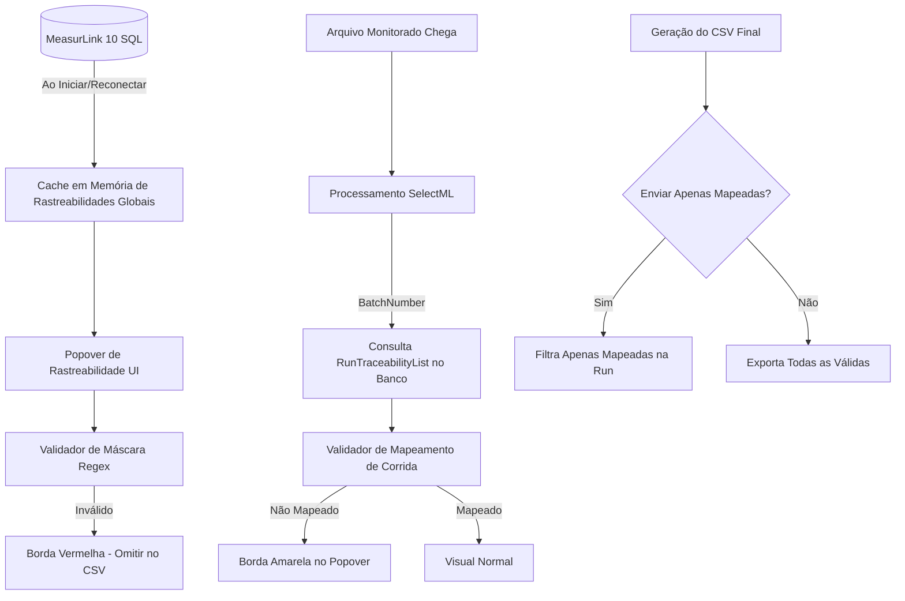

# Plano de Implementação: Mecanismo de Rastreabilidade Integrado ao MeasurLink 10 (V1.2.9 - Fase 2)

**Versão Alvo:** 1.2.9  
**Tipo:** Nova Funcionalidade / Integração com Banco de Dados MeasurLink 10  
**Status:** Planejamento e Arquitetura para Alinhamento  
**Data:** 17/10/2026  
**Documento Técnico de Referência:** [traceability_measurlink_guide.md](file:///c:/Antigravity/SelectML/docs/implementations/v1.2.9/traceability_measurlink_guide.md)  
**Branch de Desenvolvimento:** `feature/v1.2.9-traceability-and-bugfixes` (baseada em `release/v1.2.9`)  

---

## 1. Visão Geral e Objetivos

Na Fase 1 da versão **V1.2.9**, entregamos com sucesso o mecanismo de rastreabilidade manual (Popover suspenso, campo fixo de Número de Série, adição livre de pares Nome/Valor e exportação via Keywords).

Na **Fase 2**, evoluiremos este mecanismo conectando-o diretamente à inteligência cadastral do **Mitutoyo MeasurLink 10**. O objetivo é permitir que o operador não precise memorizar ou digitar manualmente os nomes e regras de rastreabilidade de cada processo, oferecendo:

1. **Sugestão de Campos de Catálogo:** A coluna "Nome" do Popover passa a ser um `ComboBox` editável, listando todas as rastreabilidades ativas cadastradas no banco de dados (`TraceabilityFolderType = 1`), permitindo tanto a seleção rápida quanto a digitação livre.
2. **Adaptação Dinâmica da Coluna "Valor" (`ItemType`):** Se a rastreabilidade selecionada possuir opções pré-definidas no MeasurLink (`TraceabilityItem`):
   - **`ItemType = 1` (Seleção Estrita):** O campo "Valor" torna-se um `ComboBox` fechado (`IsEditable = false`), impedindo digitação arbitrária e restringindo às opções oficiais de catálogo (ex: lista fixa de Inspetores, Máquinas ou Instrumentos).
   - **`ItemType = 2` (Seleção com Adição):** O campo torna-se um `ComboBox` aberto (`IsEditable = true`), permitindo escolher da lista ou digitar um novo valor.
   - **`ItemType = 3` (Texto Livre com Máscara):** O campo mantém-se como caixa de texto com validação e dica visual de preenchimento baseada no exemplo do MeasurLink.
3. **Validação Automática de Máscara Regex (`Pattern`):** Para campos com restrição ativa no banco (como `N° Desenho`, `Tempo de peça`, `Operador`, `Quantidade`), a entrada é validada em tempo real contra a expressão regular binária configurada no MeasurLink. Caso não cumpra a regra, o campo recebe destaque visual vermelho (`Brush.Status.Error`) e a linha correspondente é omitida no CSV exportado.
4. **Validação de Corrida Ativa (`RunID`) e Destaque Informativo:** Ao processar um arquivo de medição, o SelectML identifica a corrida ativa e checa se as rastreabilidades preenchidas no Popover fazem parte das regras mapeadas para este lote (`RunTraceabilityList`).
   - Se uma rastreabilidade preenchida não estiver mapeada na corrida ativa, ela é sinalizada com uma **borda âmbar/amarela** (`Brush.Status.Warning`), alertando o operador visualmente.
5. **Configuração de Exportação ("Enviar apenas rastreabilidades mapeadas"):** Nova opção adicionada ao menu superior **Configuração**:
   - **Ativa (Check):** Apenas as rastreabilidades que existam e estejam mapeadas no `RunID` atual são exportadas no CSV final.
   - **Desativada (Padrão):** Todas as rastreabilidades válidas preenchidas são exportadas normalmente.

---

## 2. Diagnóstico no Banco de Dados Real (`MeasurLink10`)

Realizamos a inspeção direta na instância local de homologação (`localhost\MLSQLEXPRESS`, banco `MeasurLink10`), validando as estruturas e dados reais:

### 2.1 Separação entre Rastreabilidades e Causas Assinaláveis
* Pastas com `TraceabilityFolderType = 1` contêm as **Rastreabilidades de Produção** reais:
  * `Machine Shop`: `Heat Value` (ID 1), `Operators` (ID 2).
  * `RASTREABILIDADE`: `Preparador` (ID 6, 10 opções), `Inspetor` (ID 7, 6 opções), `Máquina` (ID 10, 20 opções), `Operador` (ID 28, ItemType 6).
  * `EQUIPAMENTOS`: `Paquímetro` (ID 21), `Micrômetro de lâmina` (ID 22), `Micrômetro` (ID 23), `Projetor` (ID 24), `Microscópio` (ID 25), `Metrologia` (ID 30), `Micrômetro de ponta` (ID 31).
  * `DESENHO`: `N° Desenho` (ID 26, ItemType 3), `Tempo de peça` (ID 27, ItemType 3), `Quantidade` (ID 29, ItemType 3).
* Pastas com `TraceabilityFolderType = 2` contêm **Causas Assinaláveis / Motivos de Parada** (`TIPO DE PARADAS`, `Assignable Cause` com campos como `MÁQUINA`, `PROCESSO`, `PESSOAS`, `MATERIAL`, `GESTÃO`, `Broken Tool`).
* **Conclusão:** O filtro `tf.TraceabilityFolderType = 1` é rigorosamente necessário e suficiente para isolar apenas as rastreabilidades relevantes ao operador.

### 2.2 Decodificação do `Pattern` Binário (.NET BinaryFormatter)
Executamos o decodificador `TraceMaskInfo.Parse` contra os registros reais da tabela `TraceabilityList`:
* `N° Desenho` (ID 26): `IsEnabled = True`, `Pattern = (\d{4})`, `Sample = 0000` (exige estritamente 4 dígitos numéricos).
* `Tempo de peça` (ID 27): `IsEnabled = True`, `Pattern = (\d){2}'(\d){2}''`, `Sample = 00'00''` (formato de minutos e segundos).
* `Operador` (ID 28): `IsEnabled = True`, `Pattern = (.{5,})`, `Sample = 5 Digitos` (mínimo de 5 caracteres).
* `Quantidade` (ID 29): `IsEnabled = True`, `Pattern = (\d{1,5})`, `Sample = 100` (1 a 5 dígitos).
* `Preparador` (ID 6): `IsEnabled = False` (máscara inativa, utiliza opções da lista).
* **Conclusão:** O decodificador binário funciona com 100% de precisão nos dados nativos do MeasurLink 10.

### 2.3 Rastreabilidades Mapeadas em Corridas Reais (`RunTraceabilityList`)
Testamos corridas ativas como `067336-092026` (RunID 701) e históricas como `056189-022026` (RunID 12).
* Na corrida `056189-022026`, os campos mapeados são: `Preparador` (ItemType 2), `Inspetor` (ItemType 1), `Máquina` (ItemType 1), instrumentos de medição (`Paquímetro`, `Micrômetro`, etc.), `N° Desenho`, `Tempo de peça` e `Operador`.
* **Conclusão:** A verificação por `RunID` permite ao SelectML saber imediatamente quais campos foram solicitados pela engenharia de qualidade do MeasurLink para aquele lote específico.

---

## 3. Arquitetura Técnica e Otimizações

### 3.1 Modelo de Dados e Otimização de Performance
Para evitar consultas recorrentes ao banco a cada tecla digitada ou durante renderizações WPF, adotaremos uma estratégia de **Cache Local em Memória**:

1. **Carga do Catálogo Global (`GetAllAvailableTraceabilitiesAsync`):**
   * Ao inicializar a aplicação (ou reconectar ao banco de dados), carrega-se em segundo plano o catálogo global de rastreabilidades e suas opções (`TraceabilityItem`).
   * Como o catálogo típico possui poucas dezenas de itens, ele é mantido em uma lista em memória no serviço, proporcionando resposta instantânea (< 1 ms) para autocompletar e validação.
2. **Resolução de Corrida por Lote (`GetRunTraceabilitiesAsync(string runName)`):**
   * Ao detectar o `BatchNumber` do arquivo processado, o serviço executa uma consulta otimizada utilizando `WITH (NOLOCK)` em `ActiveRun` e `Run`, retornando o conjunto de `TraceabilityListID` / `ListName` mapeados para aquele lote.
3. **Resiliência a Falhas (Modo Offline / Sem Banco):**
   * Se a conexão com o banco estiver indisponível ou cair temporariamente:
     * O Popover continua funcionando perfeitamente no modo manual (digitação livre), exatamente como na Fase 1.
     * Nenhuma exceção não tratada ou bloqueio da UI ocorre.

---

## 4. Estrutura de Controles e Experiência do Usuário (UI/UX)

### 4.1 Linhas de Rastreabilidade no Popover
Cada linha de rastreabilidade na coleção agora possui comportamentos dinâmicos:

| Elemento | Tipo de Controle | Comportamento e Regras |
| :--- | :--- | :--- |
| **Coluna "Nome"** | `ComboBox` com `IsEditable="True"` | Exibe a lista de nomes do catálogo MeasurLink. Permite que o operador escolha uma opção existente ou digite um nome livre customizado. |
| **Coluna "Valor"** | Reativo (`ComboBox` / `TextBox`) | • **Se `ItemType = 1`**: `ComboBox` com `IsEditable="False"` contendo as opções oficiais cadastradas (ex: nomes de Inspetores). Não aceita texto fora da lista. • **Se `ItemType = 2`**: `ComboBox` com `IsEditable="True"` contendo as opções oficiais, permitindo escolha ou digitação livre. • **Se `ItemType = 3` ou Não Cadastrado**: `TextBox` permitindo digitação livre com validação da máscara Regex (exibindo placeholder/exemplo como watermark quando disponível). |
| **Botão Excluir** | Botão `✕` | Remove a linha da coleção normalmente. |

### 4.2 Sinalização Visual de Bordas e Prioridades

As bordas dos campos no Popover refletem seu estado atual com rigorosa hierarquia visual:

1. **🔴 Erro Crítico (`Brush.Status.Error`, Vermelho):**
   * Condição 1: Campo incompleto (Nome preenchido e Valor vazio, ou vice-versa).
   * Condição 2: Valor preenchido que não cumpre a máscara Regex cadastrada (`IsMaskInvalid = true`).
   * *Ação de Envio:* O item é omitido na exportação CSV para não quebrar a importação no MeasurLink.
2. **🟡 Advertência de Corrida (`Brush.Status.Warning`, Âmbar / Amarelo):**
   * Condição: O campo está completamente preenchido e válido em sua máscara, porém **não pertence** ao `RunTraceabilityList` do lote (`RunID`) atualmente carregado.
   * *Ação de Envio:* Se a opção "Enviar apenas rastreabilidades mapeadas" estiver ativa, é omitido; se estiver inativa, é enviado.
3. **⚪ Estado Normal (`Brush.Border.Base` / Neutro):**
   * Campo preenchido e compatível, ou campo em branco.

---

## 5. Pontos de Confirmação e Alinhamento

Antes de prosseguirmos com a codificação das sprints, os seguintes pontos arquiteturais são destacados para seu alinhamento:

### Ponto 1: Comportamento quando o Usuário Digita um Nome Não Cadastrado no Banco
* **Proposta:** Se o operador digitar um nome customizado que não existe no catálogo do MeasurLink (ex: `LoteInterno`), o campo "Valor" comportar-se-á como `TextBox` de texto livre padrão (sem máscara e sem restrições de lista), mantendo 100% da flexibilidade atual da Fase 1.
* *Status:* Recomendado e previsto na especificação.

### Ponto 2: Comportamento ao Selecionar uma Rastreabilidade com `ItemType = 1`
* **Proposta:** Ao escolher uma rastreabilidade estrita (como `Inspetor`), se o operador já tiver digitado um valor no campo "Valor" que não faz parte da lista pré-definida, o campo "Valor" é limpo ou definido para a primeira opção válida da lista, evitando valores ilegais para o MeasurLink.
* *Status:* Recomendado para garantir a integridade da lista estrita.

### Ponto 3: Placeholder / Watermark de Máscara
* **Proposta:** Para campos com máscara Regex ativa (ex: `N° Desenho` ou `Tempo de peça`), exibir no fundo do `TextBox` de valor (quando vazio) o texto de exemplo do MeasurLink (`0000` ou `00'00''`) em tom cinza suave (`Brush.Text.Inactive`), guiando o operador sobre o formato correto esperado.
* *Status:* Recomendado para melhor usabilidade.

### Ponto 4: Localização do Checkbox "Enviar apenas rastreabilidades mapeadas"
* **Proposta:** Posicionar no menu superior `Configuração`, imediatamente abaixo de `Listar todas as características`:
  * `[✓] Listar todas as características`
  * `[✓] Enviar apenas rastreabilidades mapeadas`
* *Status:* Totalmente aderente ao padrão existente de menus do SelectML.
