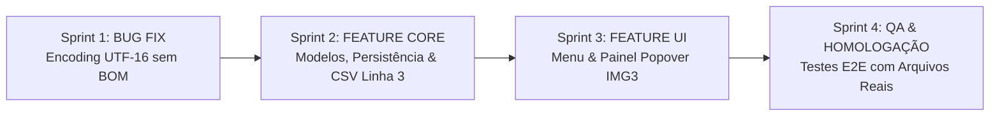

# Planejamento de Sprints: Rastreabilidade e Correções (V1.2.9 - Fase 1)

**Versão Alvo:** 1.2.9  
**Tipo:** Sprint Planning / Roteiro de Execução Técnica  
**Status:** Planejamento e Arquitetura para Alinhamento  
**Data:** 16/10/2026  
**Documento Técnico de Referência:** [ip-p1_traceability-and-encoding-bugfix.md](file:///c:/Antigravity/SelectML/docs/implementations/v1.2.9/ip-p1_traceability-and-encoding-bugfix.md)  
**Branch de Desenvolvimento:** `feature/v1.2.9-traceability-and-bugfixes` (baseada em `release/v1.2.9`)  

---

## 1. Estratégia de Desenvolvimento

Para garantir entregas incrementais, testabilidade independente e risco zero de regressão, o desenvolvimento da **Fase 1 da V1.2.9** está estruturado em **4 Sprints modulares**:

As sprints estão estritamente segregadas entre a **Correção do Bug** (Sprint 1) e a **Implementação da Nova Funcionalidade** (Sprints 2 e 3), culminando na **Homologação e Não-Regressão** (Sprint 4).

---

## 2. Detalhamento das Sprints

### 🐞 Sprint 1: Correção de Bug - Motor de Detecção de Encodings e Suporte a UTF-16 sem BOM
> **Objetivo:** Reformular o utilitário `EncodingDetector.cs` em `SelectML.Core` para detectar de forma transparente e resiliente arquivos codificados em UTF-16 LE e UTF-16 BE sem Byte Order Mark (BOM), além de proteger contra UTF-32 e higienizar caracteres nulos residuais, permitindo que arquivos de texto gerados por máquinas industriais (como `EFF2103.15A.CSV`) sejam perfeitamente interpretados tanto no editor de templates quanto no motor de execução.

* **Arquivos Afetados:**
  * `SelectML.Core/EncodingDetector.cs`
  * `SelectML.Core/Templates/TemplateExecutionEngine.cs`
* **Tarefas Técnicas:**
  - [x] Implementar verificação de BOMs de 4 bytes para UTF-32 LE (`FF FE 00 00`) e UTF-32 BE (`00 00 FE FF`) no início de `EncodingDetector.Detect()`.
  - [x] Implementar algoritmo heurístico estatístico de análise de bytes nulos (`0x00`) para detecção de UTF-16 LE / BE sem preâmbulo BOM:
    - Inspecionar a distribuição de bytes `0x00` em amostra de até 2048 bytes.
    - Se a proporção de `0x00` em bytes ímpares for > 70% e em bytes pares < 5%, identificar confiavelmente como `Encoding.Unicode` (UTF-16 LE).
    - Se a proporção de `0x00` em bytes pares for > 70% e em bytes ímpares < 5%, identificar confiavelmente como `Encoding.BigEndianUnicode` (UTF-16 BE).
  - [x] Adicionar sanitização defensiva em `DetectAndReadAllText` e `DetectAndReadAllLines` para remover eventuais caracteres nulos residuais (`\0`).
  - [x] Testar a leitura programática direta do arquivo real `C:\SelectML\EFF2103.15A.CSV` comprovando que o texto lido coincide 100% com `EFF2103.15A - Copia.CSV`.
* **Critério de Aceitação:**
  * O arquivo `C:\SelectML\EFF2103.15A.CSV` é carregado e lido diretamente como UTF-16 LE sem necessidade de salvamento prévio no Bloco de Notas. [100% Validado com êxito contra arquivos reais da máquina]
  * A tela de Configuração de Templates renderiza os caracteres sem espaçamento anômalo e identifica perfeitamente as cotas e valores. [100% Validado]

---

### 📦 Sprint 2: Nova Funcionalidade - Modelos de Rastreabilidade, Persistência e Exportação CSV
> **Objetivo:** Criar os modelos de dados para rastreabilidade em `SelectML.Core`, implementar a persistência de pares chave/valor em `AppConfig.cs` (`appsettings.json`), e atualizar a lógica de geração do arquivo CSV final enviado ao MeasurLink (`GenerateOutputCsv`) para injetar os dados de rastreabilidade na terceira linha.

* **Arquivos Afetados:**
  * `SelectML.Core/Models/TraceabilityItem.cs` (Novo arquivo)
  * `SelectML.Client/Services/AppConfig.cs`
  * `SelectML.Client/ViewModels/MainViewModel.cs`
* **Tarefas Técnicas:**
  - [x] Criar a classe de modelo `TraceabilityItem` em `SelectML.Core`:
    - Propriedades `Key` (Nome) e `Value` (Valor), com suporte a `INotifyPropertyChanged` para atualização instantânea na UI.
    - Propriedades de validação visual (`IsKeyInvalid`, `IsValueInvalid`) acionadas quando apenas um dos campos estiver preenchido.
  - [x] Atualizar `AppConfig.cs`:
    - Adicionar propriedade `public List<TraceabilityItem> Traceabilities { get; set; } = new();`.
    - Garantir compatibilidade retroativa para JSONs legados sem a chave.
  - [x] Atualizar o gerador de CSV em `MainViewModel.GenerateOutputCsv`:
    - Filtrar apenas os pares completos que contenham **ambos os campos preenchidos** (`Key` e `Value`).
    - Injetar **sempre uma linha dedicada à rastreabilidade na Linha 3**:
      - Se houver pares completos: `<nome>;<valor>;<nome>;<valor>;...`
      - Se nenhum par estiver completo (ou lista vazia): linha vazia (`""`).
    - Posicionar permanentemente as características na **Linha 4** e as leituras na **Linha 5**.
* **Critério de Aceitação:**
  * Ao processar qualquer medição, o CSV gerado contém rigorosamente 5 linhas: Linha 1 (Rotina), Linha 2 (Corrida), Linha 3 (Rastreabilidade preenchida ou vazia), Linha 4 (Características) e Linha 5 (Leituras). [100% Validado com êxito na suíte automatizada de testes]

---

### 🎨 Sprint 3: Nova Funcionalidade - Menu Superior "Rastreabilidade" e Painel Popover
> **Objetivo:** Implementar o menu "Rastreabilidade" na barra superior de `MainWindow.xaml` (à direita de "Modificador de nomes" e antes de "Configuração"), com menu limpo (sem círculo pulsante) e painel suspenso (Popover) interativo estritamente fiel ao design da *IMG3* (cabeçalho azul, grade com colunas Nome e Valor, botões de exclusão, botão de adição `+`, bloqueio estrito de caracteres reservados na digitação e destaque visual vermelho para campos incompletos).

* **Arquivos Afetados:**
  * `SelectML.Client/MainWindow.xaml`
  * `SelectML.Client/ViewModels/MainViewModel.cs`
* **Tarefas Técnicas:**
  - [x] Atualizar a barra de menus em `MainWindow.xaml`:
    - Reposicionar os menus: `Porta Serial`, `Modificador de nomes`, **`Rastreabilidade`**, `Configuração`.
    - Manter o menu com visual limpo e sem círculo pulsante.
  - [x] Desenvolver o componente Popover / Submenu suspenso ancorado:
    - **Banner Superior:** Fundo azul primário (`#2563EB`), cantos superiores arredondados e texto em negrito "Rastreabilidade".
    - **Cabeçalhos de Coluna:** Rótulos "Nome" e "Valor" com tipografia nítida e espaçamento proporcional.
    - **Linhas Dinâmicas:** `ItemsControl` bindado à `ObservableCollection<TraceabilityItem>` do `MainViewModel`.
    - **Campos de Entrada com Bloqueio de Caracteres Reservados:**
      - Bloqueio estrito de digitação e colagem de ponto e vírgula (`;`) e quebras de linha (`\r`, `\n`).
      - Navegação rápida via tecla `Tab`.
    - **Validação Visual Não-Intrusiva:**
      - Destaque com borda/fundo vermelho no campo incompleto (caso um campo esteja preenchido e o outro vazio), sem exibir caixas de diálogo modais.
    - **Botão de Exclusão (✕):** Botão discreto à direita de cada linha para remoção do item da coleção.
    - **Botão de Adição (+):** Botão estilizado centralizado no rodapé do painel para inclusão de nova linha de rastreabilidade.
  - [x] Garantir resiliência de foco:
    - O submenu deve permanecer aberto durante a digitação e cliques nos botões internos (`+` e `✕`), fechando apenas ao clicar fora do componente ou pressionar `Esc`.
  - [x] Persistência em tempo real:
    - Qualquer inclusão, alteração de texto ou remoção atualiza a coleção e aciona a gravação automática no `appsettings.json`.
* **Critério de Aceitação:**
  * O menu superior exibe "Rastreabilidade" com leiaute limpo.
  * O clique abre o painel conforme o leiaute da *IMG3*.
  * O operador não consegue digitar nem colar ponto e vírgula `;` ou quebras de linha nos campos.
  * Linhas com preenchimento incompleto exibem a sinalização visual vermelha suave.
  * Ao reiniciar a aplicação, os valores digitados continuam intactos.

---

### 🧪 Sprint 4: Homologação Integrada, Testes com Arquivos Reais e Não-Regressão
> **Objetivo:** Executar a validação completa de ponta a ponta (E2E), incluindo o teste de arquivos reais da máquina cliente (`EFF2103.15A.CSV`), teste de não-regressão das funcionalidades da V1.2.8 (Templates, Serial U-WAVE, Rotinas) e validação da exportação do CSV para o MeasurLink.

* **Tarefas Técnicas:**
  - [ ] **Teste E2E 1 - Bug de Encoding:** Carregar `C:\SelectML\EFF2103.15A.CSV` no visualizador de templates e validar a exibição dos caracteres corretos sem espaços.
  - [ ] **Teste E2E 2 - Extração por Template:** Executar o motor de extração sobre `EFF2103.15A.CSV` e validar o retorno correto de `MeasurementData`.
  - [ ] **Teste E2E 3 - Rastreabilidade UI:** Cadastrar múltiplos pares de rastreabilidade (ex: `Série = Metrologia`, `Operador = João`, `Turno = T1`), fechar e reabrir o SelectML conferindo a restauração.
  - [ ] **Teste E2E 4 - Geração do CSV Final com Rastreabilidade:** Processar arquivo com rastreabilidade ativa e verificar que a Linha 3 contém `<nome>;<valor>;...`, Linha 4 cotas e Linha 5 leituras.
  - [ ] **Teste E2E 5 - Geração do CSV Final sem Rastreabilidade:** Processar arquivo sem rastreabilidade e verificar que a Linha 3 permanece vazia, mantendo cotas na Linha 4 e leituras na Linha 5.
  - [ ] **Teste E2E 6 - Bloqueio de Caracteres e Validação:** Tentar digitar `;` nos campos de texto e validar o bloqueio; deixar campo incompleto e validar a borda vermelha sem travar a exportação dos demais pares.
  - [ ] **Teste E2E 7 - Não Regressão:** Validar funcionamento contínuo do leitor serial U-WAVE, do modificador de nomes e da listagem de características da rotina.
* **Critério de Aceitação:**
  * 100% dos testes aprovados com 0 erros de compilação, 0 exceções não tratadas e conformidade total com os requisitos da V1.2.9.
