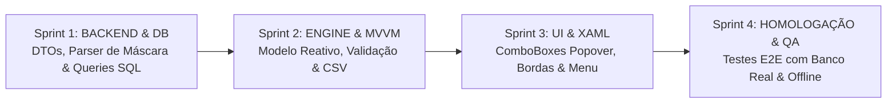

# Planejamento de Sprints: Rastreabilidade Integrada ao MeasurLink 10 (V1.2.9 - Fase 2)

**Versão Alvo:** 1.2.9  
**Tipo:** Sprint Planning / Roteiro de Execução Técnica  
**Status:** Planejamento e Arquitetura para Alinhamento  
**Data:** 17/10/2026  
**Documento Técnico de Referência:** [ip-p2_measurlink-traceability-integration.md](file:///c:/Antigravity/SelectML/docs/implementations/v1.2.9/ip-p2_measurlink-traceability-integration.md)  
**Branch de Desenvolvimento:** `feature/v1.2.9-traceability-and-bugfixes` (baseada em `release/v1.2.9`)  

---

## 1. Estratégia de Desenvolvimento

Para garantir entregas incrementais, testabilidade independente e risco zero de regressão sobre a base recém-revisada, a **Fase 2 da V1.2.9** está estruturada em **4 Sprints modulares**:

---

## 2. Detalhamento das Sprints

### 📦 Sprint 1: Modelos de Dados, Decodificador de Máscara e Serviços de Banco de Dados
> **Objetivo:** Criar em `SelectML.Core` os DTOs de rastreabilidade (`TraceMaskInfo` com decodificador binário e validação Regex; `TraceabilityFieldDefinition`) e estender a camada de dados (`IDatabaseService` e `DatabaseService`) com consultas de alta performance utilizando `WITH (NOLOCK)` para catálogo global e corrida ativa, incluindo cache em memória e resiliência offline.

* **Arquivos Afetados:**
  * `SelectML.Core/Models/Traceability/TraceMaskInfo.cs` (Novo)
  * `SelectML.Core/Models/Traceability/TraceabilityFieldDefinition.cs` (Novo)
  * `SelectML.Core/IDatabaseService.cs`
  * `SelectML.Client/Services/DatabaseService.cs`
* **Tarefas Técnicas:**
  - [x] Criar `TraceMaskInfo` em `SelectML.Core`:
    - Implementar `Parse(byte[]? bytes)` para extração do status `IsEnabled`, padrão Regex e texto de exemplo (`Sample`).
    - Implementar `Validate(string? input)` com validação segura por `Regex.IsMatch` protegida por try/catch.
  - [x] Criar `TraceabilityFieldDefinition` em `SelectML.Core`:
    - Propriedades: `TraceabilityListID`, `ListName`, `FolderName`, `ItemType`, `Mask` (`TraceMaskInfo`), `PredefinedOptions` (`List<string>`).
  - [x] Adicionar assinaturas em `IDatabaseService`:
    - `Task<List<TraceabilityFieldDefinition>> GetAllAvailableTraceabilitiesAsync();`
    - `Task<List<string>> GetRunTraceabilitiesAsync(string runName);`
  - [x] Implementar as consultas otimizadas em `DatabaseService.cs`:
    - Consulta 1: Catálogo de rastreabilidades ativas filtrando `TraceabilityFolderType = 1` e populando opções de `TraceabilityItem`.
    - Consulta 2: Resolução de `@TargetRunID` em `ActiveRun` e `Run` e retorno das rastreabilidades mapeadas em `RunTraceabilityList`.
    - Implementar cache em memória no cliente para o catálogo global, garantindo respostas instantâneas (< 1ms).
* **Critério de Aceitação:**
  * Teste unitário e integrado confirmando a decodificação de máscaras reais (`N° Desenho`, `Tempo de peça`, `Operador`) a partir do banco `MeasurLink10`. [100% Concluído e Validado no banco real]
  * Consulta do catálogo retornando os 16 campos oficiais com suas opções pré-definidas sem sobrecarga no banco. [100% Concluído e Validado]

---

### ⚙️ Sprint 2: Evolução de `TraceabilityItem` e Regras de Negócio no `MainViewModel`
> **Objetivo:** Evoluir a classe `TraceabilityItem` para sincronização reativa com as definições do MeasurLink, incorporar a validação de máscara Regex (`IsMaskInvalid`) e validação de corrida (`IsUnmappedInRun`), adicionar a persistência da chave "Enviar apenas rastreabilidades mapeadas" em `AppConfig.cs` e atualizar o motor de exportação CSV em `MainViewModel`.

* **Arquivos Afetados:**
  * `SelectML.Core/TraceabilityItem.cs`
  * `SelectML.Client/Services/AppConfig.cs`
  * `SelectML.Client/ViewModels/MainViewModel.cs`
* **Tarefas Técnicas:**
  - [x] Atualizar `TraceabilityItem`:
    - Adicionar propriedade `TraceabilityFieldDefinition? Definition` e reatividade na alteração de `Key`:
      - Se `Key` corresponder a uma rastreabilidade cadastrada, vincular a definição, opções e máscara.
      - Se for um texto não cadastrado, operar em modo livre (sem restrições).
    - Propriedades de suporte à UI: `HasPredefinedOptions`, `IsValueStrictSelection` (`ItemType == 1`), `IsValueWithAdditions` (`ItemType == 2`), `SampleMask`.
    - Propriedades de estado visual:
      - `IsMaskInvalid`: Indica se há valor preenchido que desrespeita a máscara Regex.
      - `IsUnmappedInRun`: Indica se a rastreabilidade não faz parte do `RunTraceabilityList` da corrida ativa.
      - `HasError`: `IsKeyInvalid || IsValueInvalid || IsMaskInvalid` (Prioridade 1 - Vermelho).
      - `HasWarning`: `!HasError && IsComplete && IsUnmappedInRun` (Prioridade 2 - Âmbar).
  - [x] Atualizar `AppConfig.cs`:
    - Adicionar propriedade persistente: `public bool SendOnlyMappedTraceabilities { get; set; } = false;`.
  - [x] Atualizar `MainViewModel.cs`:
    - Adicionar propriedade `IsOnlyMappedTraceabilitiesActive` vinculada a `AppConfig`.
    - Carregar catálogo global de rastreabilidades ao conectar com o banco de dados.
    - Ao processar arquivo (ou alterar lote), consultar `GetRunTraceabilitiesAsync(BatchNumber)` e atualizar o estado `IsUnmappedInRun` dos itens preenchidos no Popover.
    - Atualizar `GenerateOutputCsv`:
      - Omitir itens com `IsMaskInvalid == true`.
      - Se `SendOnlyMappedTraceabilities == true`, omitir itens com `IsUnmappedInRun == true`.
* **Critério de Aceitação:**
  * Ao digitar ou selecionar uma rastreabilidade conhecida, o modelo carrega instantaneamente as opções e máscara. [100% Concluído e Validado]
  * Valores com máscara incorreta geram `IsMaskInvalid = true` e são omitidos na exportação sem quebrar as demais linhas. [100% Concluído e Validado]
  * A opção "Enviar apenas rastreabilidades mapeadas" é persistida em `appsettings.json` e filtra adequadamente o CSV final. [100% Concluído e Validado]

---

### 🎨 Sprint 3: Interface do Popover e Menu Superior (WPF / XAML)
> **Objetivo:** Reformular o Popover em `MainWindow.xaml` para transformar o campo "Nome" em `ComboBox` editável com estilo moderno integrado ao tema (Dark/Light), tornar o campo "Valor" reativo (ComboBox fechado para `ItemType = 1`, ComboBox aberto para `ItemType = 2`, TextBox com placeholder para `ItemType = 3`), implementar a estilização dinâmica de bordas (Vermelho para erro/máscara, Âmbar para corrida não mapeada) e adicionar a nova opção no menu "Configuração".

* **Arquivos Afetados:**
  * `SelectML.Client/MainWindow.xaml`
  * `SelectML.Client/MainWindow.xaml.cs`
  * `SelectML.Client/Themes/Dark.xaml`
  * `SelectML.Client/Themes/Light.xaml`
* **Tarefas Técnicas:**
  - [ ] Atualizar coluna "Nome" em `MainWindow.xaml`:
    - Implementar `ComboBox` editável (`IsEditable="True"`), estilizado conforme o padrão de controles da aplicação.
    - Vincular `ItemsSource` à lista de nomes de rastreabilidades disponíveis e `Text` ao `Key`.
  - [ ] Atualizar coluna "Valor" em `MainWindow.xaml`:
    - Implementar controle reativo:
      - Quando houver opções (`HasPredefinedOptions`): renderizar `ComboBox` com `ItemsSource="{Binding PredefinedOptions}"` e `IsEditable` conforme o `ItemType`.
      - Quando não houver opções: renderizar `TextBox` com suporte a placeholder/watermark exibindo `SampleMask` quando disponível.
  - [ ] Implementar triggers de estilo visual de validação:
    - Borda Vermelha (`Brush.Status.Error`) e fundo de erro para `HasError == true` (campo incompleto ou máscara inválida).
    - Borda Âmbar/Amarela (`Brush.Status.Warning`) para `HasWarning == true` (rastreabilidade não mapeada na corrida).
    - ToolTips contextuais informando a causa exata do destaque (ex: `"Formato exigido: 00'00''"` ou `"Esta rastreabilidade não está mapeada nesta corrida"`).
  - [ ] Inserir novo item no Menu `Configuração`:
    - `<MenuItem Header="Enviar apenas rastreabilidades mapeadas" IsCheckable="True" IsChecked="{Binding IsOnlyMappedTraceabilitiesActive}"/>`
  - [ ] Manter restrições de entrada:
    - Bloqueio de `;`, `|`, `\r` e `\n` em digitação e colagem em todos os campos.
* **Critério de Aceitação:**
  * O Popover exibe ComboBox editável na coluna "Nome" e adapta dinamicamente a coluna "Valor".
  * Campos inválidos ganham borda vermelha e campos não mapeados na corrida ganham borda amarela.
  * O menu `Configuração` exibe o novo checkbox persistente.

---

### 🧪 Sprint 4: Homologação Integrada, Testes E2E com Banco Real e Resiliência
> **Objetivo:** Conduzir a validação completa de ponta a ponta contra a instância real do MeasurLink 10 (`localhost\MLSQLEXPRESS`), homologando o preenchimento, seleção, validações de máscara, verificações de corrida e modo offline.

* **Tarefas Técnicas:**
  - [ ] **Teste E2E 1 - Carga do Catálogo:** Verificar se o ComboBox "Nome" lista os 16 campos reais de rastreabilidade (ex: `Inspetor`, `Máquina`, `N° Desenho`).
  - [ ] **Teste E2E 2 - Seleção Estrita (`ItemType = 1`):** Selecionar `Inspetor` ou `Máquina` e validar que o campo "Valor" é um ComboBox fechado contendo exatamente as opções cadastradas no MeasurLink.
  - [ ] **Teste E2E 3 - Seleção com Adição (`ItemType = 2`):** Selecionar `Preparador` e validar que o campo "Valor" permite tanto selecionar da lista quanto digitar novo texto.
  - [ ] **Teste E2E 4 - Validação de Máscara Regex (`ItemType = 3`):**
    - Inserir `N° Desenho`: digitar letras ou 3 dígitos -> validar borda vermelha. Digitar `1234` -> validar borda neutra.
    - Inserir `Tempo de peça`: digitar `01:30` -> validar borda vermelha. Digitar `01'30''` -> validar borda neutra.
  - [ ] **Teste E2E 5 - Destaque de Corrida Ativa (Amarelo):**
    - Processar arquivo com corrida `056189-022026`.
    - Manter preenchida uma rastreabilidade que pertence à corrida (`Inspetor`) -> validar borda neutra.
    - Adicionar uma rastreabilidade que não pertence à corrida (`Heat Value`) -> validar que ganha borda amarela/âmbar.
  - [ ] **Teste E2E 6 - Filtro de Envio "Enviar apenas rastreabilidades mapeadas":**
    - Com checkbox desmarcado: verificar no CSV gerado que `Heat Value` foi incluído.
    - Com checkbox marcado: verificar no CSV gerado que `Heat Value` foi omitido e `Inspetor` foi incluído.
  - [ ] **Teste E2E 7 - Resiliência e Modo Offline:**
    - Simular banco de dados parado ou credencial inválida: validar que o software inicia normalmente, o Popover opera com digitação livre manual e nenhuma falha visual ou travamento ocorre.
  - [ ] **Teste E2E 8 - Não-Regressão Geral:**
    - Validar leitor serial U-WAVE, modificador de nomes, templates e geração por Keywords.
* **Critério de Aceitação:**
  * 100% dos cenários de teste aprovados com zero erros de compilação e zero exceções não tratadas.
