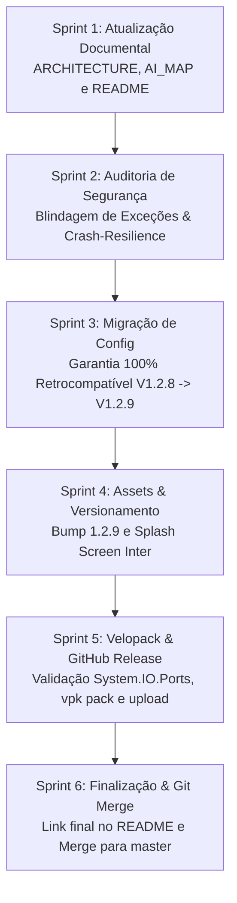

# Plano de Desenvolvimento - V1.2.9 Fase Final: Auditoria de Segurança, Documentação e Deployment Velopack

Este documento consolida o planejamento, checklist de segurança, verificação de compatibilidade retroativa e o procedimento de homologação e deployment da versão **V1.2.9** do SelectML.

---

## 📌 Status do Plano Anterior (Fases 1 e 2)
> **Verificação:** Todas as tarefas e sprints das Fases 1 e 2, incluindo as correções práticas (Sprint 5), foram **100% implementadas, testadas e validadas**:
> - ✅ **Fase 1**: Motor de detecção de codificação UTF-16 LE/BE sem BOM (`EFF2103.15A.CSV`), modelo de pares `TraceabilityItem`, injeção no CSV com formato Keywords (`ROTINA|...`, `CORRIDA|...`, `NS|...`, `RASTREABILIDADE|...`, `DADO|...`) e Popover interativo no menu superior.
> - ✅ **Fase 2**: Integração profunda com banco MeasurLink (decodificador de máscaras Regex, verificação de corrida ativa em tempo real, dropdown adaptativo por `ItemType` e opção de filtro de envio no menu Configuração).
> - ✅ **Revisão de Textos**: Integração completa de todos os textos revisados em PT-BR a partir do revisor interativo.
> - ✅ **Sprint 5 (Hotfixes Práticos)**:
>   - Correção do wipe de rastreabilidades no clique de "Salvar e Iniciar" (preservação resiliente de snapshot e sincronização in-loco).
>   - Debounce de 350ms com `CancellationTokenSource` para digitação rápida em *Nome da corrida* e *Nome da peça* (eliminação de travamentos e race conditions).
>   - Filtro restritivo da ComboBox de cotas não reconhecidas para exibir estritamente características do tipo Variável (`KnownVariableFeatures`).

**Conclusão:** Não resta nenhuma pendência funcional ou técnica pendente das fases de desenvolvimento.

---

## 📋 Metas da Fase Final (Release & Deployment V1.2.9)

---

## 🛠️ Detalhamento das Sprints da Fase Final

### 📝 Sprint 1: Atualização e Sincronização de Documentações Públicas e Internas
* **Arquivos:**
  * `docs/ARCHITECTURE.md`
  * `docs/AI_CODEBASE_MAP.md`
  * `README.md`
* **Tarefas Técnicas:**
  - [ ] **`ARCHITECTURE.md`**:
    - Incorporar arquitetura do Motor Universal de Rastreabilidade e Catálogo MeasurLink (`TraceabilityItem`, `TraceabilityFieldDefinition`, `TraceabilityMaskDefinition`, `RunTraceabilityList`).
    - Documentar novo padrão de saída CSV estruturado por Keywords (`ROTINA|`, `CORRIDA|`, `NS|`, `RASTREABILIDADE|`, `DADO|`).
    - Descrever motor heurístico de detecção de encodings UTF-16 LE/BE sem BOM e UTF-32.
    - Documentar camada de debounce reativo e mitigação de race condition nos campos de entrada da UI.
  - [ ] **`AI_CODEBASE_MAP.md`**:
    - Atualizar diagrama de componentes e novas classes de modelo e serviços em `SelectML.Core`.
    - Documentar diretrizes estritas para futuras IAs: uso de `CatalogResolver`, interação com `AvailableTraceabilityNames`, `KnownVariableFeatures`, campos debouncados e formato de exportação de dados.
  - [ ] **`README.md`**:
    - Atualizar badge de versão para `1.2.9`.
    - Adicionar seção elegante e detalhada da versão 1.2.9 no topo e mover a 1.2.8 para a seção colapsável de histórico.

---

### 🛡️ Sprint 2: Auditoria de Segurança, Crash Resilience e Blindagem de Exceções
* **Arquivos:**
  * `SelectML.Client/ViewModels/MainViewModel.cs`
  * `SelectML.Client/Services/DatabaseService.cs`
  * `SelectML.Core/TraceabilityItem.cs`
  * `SelectML.Core/TraceabilityMaskDefinition.cs`
  * `SelectML.Core/EncodingDetector.cs`
  * `scripts/Publish-Release.ps1`
* **Tarefas Técnicas:**
  - [ ] **Auditoria de Métodos `async void` e Callbacks de Eventos**:
    - Verificar todos os métodos `async void` no `MainViewModel.cs` e code-behinds para assegurar blocos `try-catch` de nível raiz com logging apropriado no Serilog.
  - [ ] **Blindagem do Motor de Máscaras e Regex**:
    - Assegurar que `TraceabilityMaskDefinition.Validate()` utilize timeout de Regex (`TimeSpan.FromMilliseconds(200)`) e captura de `RegexParseException` para impedir DoS ou congelamentos da UI em expressões malformadas.
  - [ ] **Resiliência do Serviço de Banco de Dados (`DatabaseService`)**:
    - Garantir que falhas de rede, desconexões e timeouts durante queries de catálogo ou estações retornem coleções vazias ou nulas tratadas de forma graciosa sem propagar exceção não capturada.
  - [ ] **Sanitização de Scripts de Publicação**:
    - Parametrizar ou corrigir a tag `--targetCommitish` em `Publish-Release.ps1` (removendo a referência fixa à branch legada `release/v1.2.8`).

---

### 🔄 Sprint 3: Garantia de Compatibilidade Retroativa e Migração de Configuração (`appsettings.json`)
* **Arquivos:**
  * `SelectML.Client/Services/AppConfig.cs`
  * `SelectML.Client/Services/ConfigService.cs`
* **Tarefas Técnicas:**
  - [ ] **Análise de Esquema e Migração Silenciosa**:
    - Confirmar que clientes atualizando a partir da versão **V1.2.8** mantêm 100% de suas configurações em `%APPDATA%\SelectML\appsettings.json`.
    - Verificar que as novas chaves da V1.2.9 assumem valores padrão seguros quando ausentes no JSON existente:
      - `SerialNumberTraceability`: `string.Empty`
      - `Traceabilities`: `new List<TraceabilityItem>()` (lista vazia)
      - `SendOnlyMappedTraceabilities`: `false`
    - Validar que a rotina de salvamento atômica do `ConfigService` preserva todas as propriedades prévias sem sobrescrever ou corromper dados do cliente.
  - [ ] **Teste de Carga de Configuração Legada**:
    - Simular carregamento com JSON gerado na V1.2.8 e validar integridade funcional no `MainViewModel`.

---

### 🎨 Sprint 4: Preparação de Assets, Bump de Versão e Estampagem da Splash Screen
* **Arquivos:**
  * `SelectML.Client/SelectML.Client.csproj`
  * `SelectML.Client/Resources/SelectML-splash.png`
  * `scripts/GenerateAssets.ps1`
* **Tarefas Técnicas:**
  - [ ] Incrementar a versão no arquivo `SelectML.Client.csproj`:
    - `<Version>1.2.9</Version>`
    - `<AssemblyVersion>1.2.9.0</AssemblyVersion>`
    - `<FileVersion>1.2.9.0</FileVersion>`
  - [ ] Executar o script `scripts/GenerateAssets.ps1`:
    - Gerar ícones `.ico` claros e escuros.
    - Estampar dinamicamente a marca d'água **`V1.2.9`** com tipografia *Inter* na Splash Screen (`SelectML-splash.png`).
  - [ ] Compilar localmente e verificar visualmente que a versão reportada na tela e na Splash Screen é rigorosamente `1.2.9`.

---

### 🚀 Sprint 5: Empacotamento Velopack, Validação de DLL Nativa e Publicação no GitHub Releases
* **Arquivos:**
  * `scripts/Publish-Release.ps1`
  * Pasta `Releases/`
* **Tarefas Técnicas:**
  - [ ] Limpeza do diretório de publicação anterior (`.\publish`).
  - [ ] Compilação em modo Release da solução inteira (`SelectML.sln -c Release`).
  - [ ] Publicação do projeto `SelectML.Client` em modo Release (`win-x64`, self-contained).
  - [ ] Cópia obrigatória de plugins e arquivos de configuração adicionais (`custom_device_config.json`).
  - [ ] **Validação Mandatória da DLL Nativa `System.IO.Ports.dll`** (~88 KB) para prevenir crashes de porta serial em produção.
  - [ ] Empacotamento via `vpk pack` com Splash Screen e Ícones atualizados para gerar instalador e manifestos Velopack na pasta `Releases/`.
  - [ ] Upload automatizado dos binários no GitHub Releases via `vpk upload github` utilizando a variável de ambiente `GH_TOKEN` com a tag `v1.2.9`.
  - [ ] Redigir Release Notes detalhadas no GitHub destacando todas as inovações da V1.2.9 de acordo com os padrões das versões anteriores.

---

### 🏁 Sprint 6: Finalização do README, Git Merge e Preservação de Histórico
* **Tarefas Técnicas:**
  - [ ] Atualizar o link de download no `README.md` apontando para o release oficial: `https://github.com/ramso-adnarim/SelectML/releases/tag/v1.2.9`.
  - [ ] Realizar commit final das documentações e assets atualizados no branch `feature/v1.2.9-traceability-and-bugfixes`.
  - [ ] Fazer merge do branch `feature/v1.2.9-traceability-and-bugfixes` para o branch `release/v1.2.9`.
  - [ ] Fazer merge do branch `release/v1.2.9` para o branch principal `master` preservando todo o histórico de commits.
  - [ ] Verificar integridade do repositório (`git status`, tags e histórico limpos).

---

## 🔒 Critérios de Aceitação da Fase Final
1. Zero erros ou avisos impeditivos de compilação em modo Release.
2. Migração não-destrutiva de configurações de versões anteriores (1.2.8 -> 1.2.9) homologada.
3. Splash screen estampada com `V1.2.9` e instaladores Velopack (`SelectML-win-Setup.exe` e `.nupkg`) gerados com sucesso.
4. Release oficial publicada no GitHub com binários anexados e Release Notes formatadas.
5. Histórico Git perfeitamente unificado na branch `master`.
