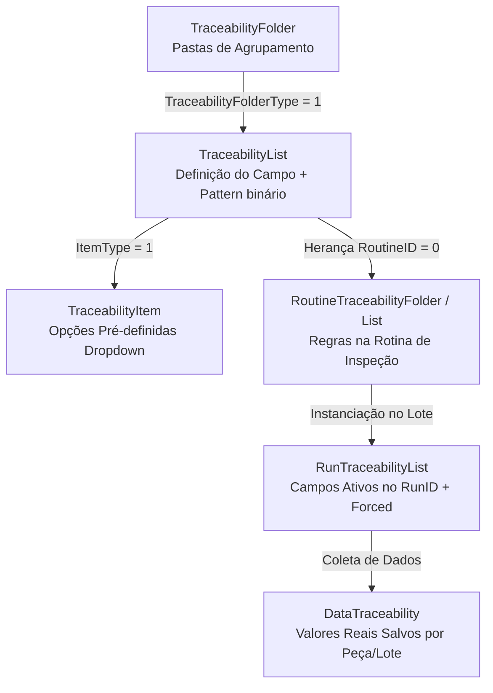

# Guia de Integração: Rastreabilidades do Mitutoyo MeasurLink 10

Este documento fornece as diretrizes arquiteturais, consultas SQL otimizadas e implementações em C# (.NET) para integrar funcionalidades de **Rastreabilidade** (*Traceability*) do software **Mitutoyo MeasurLink 10** em aplicações externas (como o `SelectML`).

---

## 1. Arquitetura do Modelo de Rastreabilidade

O MeasurLink estrutura as rastreabilidades em uma hierarquia de pastas, definições de campos, opções de catálogo e instâncias de lotes/medições:



### 1.1. Separação Crítica: Rastreabilidades vs. Causas Assinaláveis
No banco de dados, tanto as **Rastreabilidades de Produção** quanto as **Causas Assinaláveis / Motivos de Parada** compartilham as mesmas tabelas (`TraceabilityList`, `RoutineTraceabilityFolder`, `RunTraceabilityList`).

A separação é determinada pela coluna **`TraceabilityFolderType`** da tabela **`TraceabilityFolder`**:

| `TraceabilityFolderType` | Classificação no MeasurLink | Exemplos de Pastas | Exemplos de Campos | Comportamento no Sistema |
| :---: | :--- | :--- | :--- | :--- |
| **`1`** | **Rastreabilidade** (*Traceability*) | `RASTREABILIDADE`, `EQUIPAMENTOS`, `DESENHO` | `N° Desenho`, `Tempo de peça`, `Operador`, `Máquina`, `Preparador`, `Inspetor`, `Paquímetro`, `Micrômetro`... | Campos solicitados obrigatoriamente no início do lote (`Forced = 1`) ou a cada peça (`Forced = 5`). |
| **`2`** | **Causa Assinalável** (*Assignable Cause*) | `TIPO DE PARADAS`, `Assignable Cause` | `MÁQUINA`, `PROCESSO`, `PESSOAS`, `MATERIAL`, `GESTÃO`, `Broken Tool`... | Campos opcionais (`Forced = 0`), acionados apenas em exceções ou paradas de máquina. |

> [!IMPORTANT]
> **Regra de Ouro**: Todas as consultas que buscam campos de rastreabilidade para telas ou relatórios **devem obrigatoriamente** incluir o filtro `tf.TraceabilityFolderType = 1`.

---

## 2. Tipos de Campos e Regras de Obrigatoriedade

### 2.1. Modos de Entrada de Dados (`ItemType`)
A coluna `ItemType` (presente em `TraceabilityList` como catálogo padrão e em `RunTraceabilityList` / `RoutineTraceabilityList` como regra efetiva da rotina) define com precisão o comportamento do controle de interface na tela:

| `ItemType` | Nome no MeasurLink | Controle na UI (WPF / WinForms) | Comportamento do Usuário |
| :---: | :--- | :--- | :--- |
| **`1`** | **Lista de seleção sem adição** (*Selection List - No Additions*) | `ComboBox` com `IsEditable = false` | **Estrito**: O operador **só pode selecionar** dentre os itens pré-definidos de `TraceabilityItem`. Não permite digitar novo texto. |
| **`2`** | **Lista de seleção com adição** (*Selection List - With Additions*) | `ComboBox` com `IsEditable = true` | **Híbrido**: O operador pode selecionar uma opção pré-definida **ou digitar livremente** um novo valor. |
| **`3`** | **Texto livre / Máscara** (*Freeform Text*) | `TextBox` com máscara de validação | **Texto Livre**: Digitação orientada pela máscara regex (`TraceMask` em `Pattern`, ex: `N° Desenho`, `Tempo de peça`). |
| **`4`** | **Texto livre com histórico** (*Freeform Text with History*) | `ComboBox` editável com histórico recente | **Histórico**: Armazena as últimas entradas na rotina para autocompletar. |
| **`5`** | **Anexo de arquivo** (*File Attachment*) | Botão de upload/anexo | Permite associar arquivos à medição. |
| **`6`** | **Usuário / Operador** (*User*) | `TextBox` ou seleção de operador logado | Identificação do operador responsável (exige $\ge 5$ caracteres). |

### 2.2. Regras de Obrigatoriedade (`Forced`)
A coluna `rtl.Forced` na tabela `RunTraceabilityList` dita o momento em que o preenchimento deve ser exigido:

* **`Forced = 1` (Obrigatório no Início do Lote)**: Exigido apenas 1 vez na abertura do Run/Lote (ex.: `Operador`).
* **`Forced = 5` (Obrigatório a cada Peça/Subgrupo)**: Exigido em cada ciclo de medição (ex.: `N° Desenho`, `Tempo de peça`, `Máquina`, `Instrumentos`).
* **`Forced = 0` (Opcional)**: Campo livre ou ativado somente sob demanda.

---

## 3. O Mecanismo de Máscara de Preenchimento (`TraceabilityList.Pattern`)

### 3.1. Estrutura Binária do `Pattern`
A coluna `TraceabilityList.Pattern` (`varbinary(8000)`) armazena uma instância serializada em .NET da classe `Mitutoyo.MeasurLink.Shared.TraceMask`. Ela encapsula três propriedades:

1. **`Pattern`**: Expressão Regular (Regex) exata para validação do texto.
2. **`Sample`**: Máscara visual ou texto de exemplo exibido no placeholder/watermark.
3. **`IsEnabled`**: Booleano que define se a restrição de preenchimento está ativada.

### 3.2. Regras Reais Configuradas no Banco de Dados

| Campo (`ListName`) | ID | Status | Expressão Regular (Regex) | Exemplo Visual (`Sample`) | Regra de Aceitação |
| :--- | :---: | :---: | :---: | :---: | :--- |
| **N° Desenho** | `26` | **Ativa** | `(\d{4})` | `0000` | Aceita estritamente **4 dígitos numéricos** (ex: `1199`, `1478`). Não aceita letras. |
| **Tempo de peça** | `27` | **Ativa** | `(\d){2}'(\d){2}''` | `00'00''` | Exige formato de minutos e segundos (ex: `00'39''`, `01'30''`). |
| **Operador** | `28` | **Ativa** | `(.{5,})` | `5 Digitos` | Exige no mínimo **5 caracteres** (ex: `EAparecido`, `SPereira`). |
| **Quantidade** | `29` | **Ativa** | `(\d{1,5})` | `100` | Aceita de **1 a 5 dígitos numéricos** (ex: `2500`, `1000`). |

---

## 4. Consultas SQL Especializadas

### 4.1. Consulta 1: Listar Todas as Rastreabilidades Disponíveis no Banco
Recupera o catálogo global de campos de rastreabilidade ativos, excluindo causas assinaláveis:

```sql
SELECT 
    tl.TraceabilityListID,
    tl.ListName,
    tf.TraceabilityFolderID,
    tf.FolderName,
    tl.ItemType,
    CASE tl.ItemType
        WHEN 1 THEN 'Lista_Sem_Adicao'      -- ComboBox fechado (IsEditable = false)
        WHEN 2 THEN 'Lista_Com_Adicao'      -- ComboBox editável (IsEditable = true)
        WHEN 3 THEN 'Texto_Mascara'         -- TextBox com validação Regex
        WHEN 4 THEN 'Texto_Historico'       -- ComboBox com histórico
        WHEN 6 THEN 'Operador_Usuario'      -- TextBox de Operador
        ELSE 'Texto_Livre'
    END AS ModoEntradaUI,
    CASE 
        WHEN tl.ItemType IN (1, 2) THEN 'ComboBox'
        ELSE 'TextBox'
    END AS TipoControleBase,
    (SELECT COUNT(*) 
     FROM TraceabilityItem ti WITH (NOLOCK) 
     WHERE ti.TraceabilityListID = tl.TraceabilityListID AND ti.Active = 1) AS QtdItensDropdown,
    tl.Pattern AS MascaraBytes
FROM TraceabilityList tl WITH (NOLOCK)
INNER JOIN TraceabilityFolder tf WITH (NOLOCK) 
    ON tl.TraceabilityFolderID = tf.TraceabilityFolderID
WHERE tf.TraceabilityFolderType = 1 -- Exclui causas assinaláveis
ORDER BY tf.TraceabilityFolderID ASC, tl.TraceabilityListID ASC;
```

---

### 4.2. Consulta 2: Listar Opções Pré-definidas de um Campo (`TraceabilityItem`)
Para campos do tipo `ComboBox` (`ItemType = 1`), obtém as opções fixas configuradas:

```sql
SELECT 
    ti.TraceabilityListID,
    ti.ItemNo,
    ti.ItemName,
    ti.Active
FROM TraceabilityItem ti WITH (NOLOCK)
WHERE ti.TraceabilityListID = @TraceabilityListID 
  AND ti.Active = 1
ORDER BY ti.ItemNo ASC;
```

---

### 4.3. Consulta 3: Rastreabilidades Aplicadas/Exigidas em um `RunID`
Obtém os campos específicos atrelados a uma corrida/lote em execução, com obrigatoriedade e máscara:

```sql
SELECT 
    rtl.TraceabilityListID,
    tl.ListName,
    tf.FolderName,
    rtl.ItemType,
    CASE rtl.ItemType
        WHEN 1 THEN 'Lista_Sem_Adicao'      -- ComboBox fechado (IsEditable = false)
        WHEN 2 THEN 'Lista_Com_Adicao'      -- ComboBox editável (IsEditable = true)
        WHEN 3 THEN 'Texto_Mascara'         -- TextBox com validação Regex
        WHEN 4 THEN 'Texto_Historico'       -- ComboBox com histórico
        WHEN 6 THEN 'Operador_Usuario'      -- TextBox de Operador
        ELSE 'Texto_Livre'
    END AS ModoEntradaUI,
    CASE 
        WHEN rtl.ItemType IN (1, 2) THEN 'ComboBox'
        ELSE 'TextBox'
    END AS TipoControleBase,
    rtl.Forced,
    CASE rtl.Forced
        WHEN 0 THEN 'Opcional'
        WHEN 1 THEN 'Obrigatorio_InicioLote'
        WHEN 5 THEN 'Obrigatorio_PorPeca'
        ELSE 'Outro'
    END AS RegraObrigatoriedade,
    (SELECT COUNT(*) 
     FROM TraceabilityItem ti WITH (NOLOCK) 
     WHERE ti.TraceabilityListID = rtl.TraceabilityListID AND ti.Active = 1) AS QtdItensDropdown,
    tl.Pattern AS MascaraBytes
FROM RunTraceabilityList rtl WITH (NOLOCK)
INNER JOIN TraceabilityList tl WITH (NOLOCK) 
    ON rtl.TraceabilityListID = tl.TraceabilityListID
INNER JOIN TraceabilityFolder tf WITH (NOLOCK) 
    ON tl.TraceabilityFolderID = tf.TraceabilityFolderID
WHERE rtl.RunID = @RunID 
  AND rtl.FeatureID = 0 -- 0 = Rastreabilidade global da peça/lote (não de cota individual)
  AND tf.TraceabilityFolderType = 1 -- Exclui causas assinaláveis
ORDER BY rtl.TraceabilityListID ASC;
```

---

### 4.4. Consulta 4: Obter Valores Históricos / Já Preenchidos no Lote
Consulta os valores reais gravados na tabela `DataTraceability`:

```sql
SELECT 
    dt.TraceabilityListID,
    tl.ListName,
    tf.FolderName,
    dt.ItemName AS ValorSalvo,
    dt.StartObsID,
    dt.EndObsID
FROM DataTraceability dt WITH (NOLOCK)
INNER JOIN TraceabilityList tl WITH (NOLOCK) 
    ON dt.TraceabilityListID = tl.TraceabilityListID
INNER JOIN TraceabilityFolder tf WITH (NOLOCK) 
    ON tl.TraceabilityFolderID = tf.TraceabilityFolderID
WHERE dt.RunID = @RunID 
  AND dt.FeatureID = 0
  AND tf.TraceabilityFolderType = 1
ORDER BY dt.TraceabilityListID ASC;
```

---

## 5. Implementação Técnica em C# (.NET)

Abaixo está o código de produção pronto para ser incorporado na camada de serviços da sua aplicação.

### 5.1. Modelos de Dados (DTOs)

```csharp
using System;
using System.Collections.Generic;

namespace SelectML.Core.Models.Traceability
{
    public enum TraceabilityControlType
    {
        SelectionListStrict = 1,       // Lista de seleção sem adição (IsEditable = false)
        SelectionListWithAdditions = 2, // Lista de seleção com adição (IsEditable = true)
        TextBoxWithMask = 3,           // Texto livre com máscara Regex
        TextBoxWithHistory = 4,        // Texto livre com histórico
        FileAttachment = 5,            // Anexo de arquivo
        User = 6,                      // Operador / Usuário
        StandardTextBox = 99
    }

    public enum TraceabilityRequirement
    {
        Optional = 0,
        MandatoryOnRunStart = 1,
        MandatoryPerPiece = 5
    }

    public class TraceMaskInfo
    {
        public bool IsEnabled { get; set; }
        public string? RegexPattern { get; set; }
        public string? SampleMask { get; set; }

        public static TraceMaskInfo? Parse(byte[]? bytes)
        {
            if (bytes == null || bytes.Length < 10) return null;

            var info = new TraceMaskInfo();
            int len = bytes.Length;

            // IsEnabled fica localizado antes do byte de encerramento 0x0B do BinaryFormatter
            if (bytes[len - 1] == 0x0B)
            {
                info.IsEnabled = bytes[len - 2] == 0x01;
            }

            // Extração das strings serializadas (marcador 0x06 do protocolo binário)
            var extractedStrings = new List<string>();
            for (int i = 0; i < len - 6; i++)
            {
                if (bytes[i] == 0x06)
                {
                    int pos = i + 5;
                    if (pos < len)
                    {
                        int strLen = bytes[pos];
                        if (strLen > 0 && pos + 1 + strLen <= len)
                        {
                            try
                            {
                                string text = System.Text.Encoding.UTF8.GetString(bytes, pos + 1, strLen);
                                extractedStrings.Add(text);
                                i = pos + strLen;
                            }
                            catch { }
                        }
                    }
                }
            }

            if (extractedStrings.Count >= 2)
            {
                info.RegexPattern = extractedStrings[0];
                info.SampleMask = extractedStrings[1];
            }
            else if (extractedStrings.Count == 1)
            {
                info.RegexPattern = extractedStrings[0];
            }

            return info;
        }

        public bool Validate(string? input)
        {
            if (!IsEnabled || string.IsNullOrEmpty(RegexPattern)) return true;
            if (string.IsNullOrEmpty(input)) return false;

            try
            {
                return System.Text.RegularExpressions.Regex.IsMatch(input, $"^{RegexPattern}$");
            }
            catch
            {
                return true;
            }
        }
    }

    public class TraceabilityFieldDefinition
    {
        public int TraceabilityListID { get; set; }
        public string ListName { get; set; } = string.Empty;
        public string FolderName { get; set; } = string.Empty;
        public TraceabilityControlType ControlType { get; set; }
        public TraceabilityRequirement Requirement { get; set; }
        public int PredefinedOptionsCount { get; set; }
        public TraceMaskInfo? Mask { get; set; }
        public List<string> PredefinedOptions { get; set; } = new();
    }
}
```

---

### 5.2. Serviço de Acesso a Dados (`MeasurLinkTraceabilityService.cs`)

```csharp
using System;
using System.Collections.Generic;
using System.Data.SqlClient;
using System.Threading.Tasks;
using SelectML.Core.Models.Traceability;

namespace SelectML.Core.Services
{
    public class MeasurLinkTraceabilityService
    {
        private readonly string _connectionString;

        public MeasurLinkTraceabilityService(string connectionString)
        {
            _connectionString = connectionString;
        }

        /// <summary>
        /// 1. Consulta todas as rastreabilidades disponíveis no banco (excluindo causas assinaláveis).
        /// </summary>
        public async Task<List<TraceabilityFieldDefinition>> GetAllAvailableTraceabilitiesAsync()
        {
            var list = new List<TraceabilityFieldDefinition>();
            const string query = @"
                SELECT 
                    tl.TraceabilityListID,
                    tl.ListName,
                    tf.FolderName,
                    tl.ItemType,
                    (SELECT COUNT(*) FROM TraceabilityItem ti WITH (NOLOCK) 
                     WHERE ti.TraceabilityListID = tl.TraceabilityListID AND ti.Active = 1) AS QtdOpcoes,
                    tl.Pattern AS MascaraBytes
                FROM TraceabilityList tl WITH (NOLOCK)
                INNER JOIN TraceabilityFolder tf WITH (NOLOCK) ON tl.TraceabilityFolderID = tf.TraceabilityFolderID
                WHERE tf.TraceabilityFolderType = 1
                ORDER BY tl.TraceabilityListID ASC;";

            using var conn = new SqlConnection(_connectionString);
            await conn.OpenAsync();
            using var cmd = new SqlCommand(query, conn);
            using var reader = await cmd.ExecuteReaderAsync();

            while (await reader.ReadAsync())
            {
                var item = MapReaderToField(reader, hasForcedColumn: false);
                list.Add(item);
            }

            return list;
        }

        /// <summary>
        /// 2. Lista as opções pré-definidas para um campo ComboBox.
        /// </summary>
        public async Task<List<string>> GetPredefinedOptionsAsync(int traceabilityListId)
        {
            var options = new List<string>();
            const string query = @"
                SELECT ItemName 
                FROM TraceabilityItem WITH (NOLOCK)
                WHERE TraceabilityListID = @ListID AND Active = 1
                ORDER BY ItemNo ASC;";

            using var conn = new SqlConnection(_connectionString);
            await conn.OpenAsync();
            using var cmd = new SqlCommand(query, conn);
            cmd.Parameters.AddWithValue("@ListID", traceabilityListId);
            using var reader = await cmd.ExecuteReaderAsync();

            while (await reader.ReadAsync())
            {
                options.Add(reader.GetString(0));
            }

            return options;
        }

        /// <summary>
        /// 3 e 4. Consulta e decodifica as rastreabilidades exigidas em um RunID específico.
        /// </summary>
        public async Task<List<TraceabilityFieldDefinition>> GetRequiredTraceabilitiesForRunAsync(int runId)
        {
            var list = new List<TraceabilityFieldDefinition>();
            const string query = @"
                SELECT 
                    rtl.TraceabilityListID,
                    tl.ListName,
                    tf.FolderName,
                    rtl.ItemType,
                    rtl.Forced,
                    (SELECT COUNT(*) FROM TraceabilityItem ti WITH (NOLOCK) 
                     WHERE ti.TraceabilityListID = rtl.TraceabilityListID AND ti.Active = 1) AS QtdOpcoes,
                    tl.Pattern AS MascaraBytes
                FROM RunTraceabilityList rtl WITH (NOLOCK)
                INNER JOIN TraceabilityList tl WITH (NOLOCK) ON rtl.TraceabilityListID = tl.TraceabilityListID
                INNER JOIN TraceabilityFolder tf WITH (NOLOCK) ON tl.TraceabilityFolderID = tf.TraceabilityFolderID
                WHERE rtl.RunID = @RunID 
                  AND rtl.FeatureID = 0
                  AND tf.TraceabilityFolderType = 1
                ORDER BY rtl.TraceabilityListID ASC;";

            using var conn = new SqlConnection(_connectionString);
            await conn.OpenAsync();
            using var cmd = new SqlCommand(query, conn);
            cmd.Parameters.AddWithValue("@RunID", runId);
            using var reader = await cmd.ExecuteReaderAsync();

            while (await reader.ReadAsync())
            {
                var item = MapReaderToField(reader, hasForcedColumn: true);
                list.Add(item);
            }

            // Carrega as opções pré-definidas para os campos ComboBox (com ou sem adição)
            foreach (var field in list)
            {
                if ((field.ControlType == TraceabilityControlType.SelectionListStrict || 
                     field.ControlType == TraceabilityControlType.SelectionListWithAdditions) && 
                    field.PredefinedOptionsCount > 0)
                {
                    field.PredefinedOptions = await GetPredefinedOptionsAsync(field.TraceabilityListID);
                }
            }

            return list;
        }

        private static TraceabilityFieldDefinition MapReaderToField(SqlDataReader reader, bool hasForcedColumn)
        {
            var field = new TraceabilityFieldDefinition
            {
                TraceabilityListID = reader.GetInt32(reader.GetOrdinal("TraceabilityListID")),
                ListName = reader.GetString(reader.GetOrdinal("ListName")),
                FolderName = reader.GetString(reader.GetOrdinal("FolderName")),
                PredefinedOptionsCount = reader.GetInt32(reader.GetOrdinal("QtdOpcoes"))
            };

            int itemTypeVal = reader.GetInt32(reader.GetOrdinal("ItemType"));
            field.ControlType = itemTypeVal switch
            {
                1 => TraceabilityControlType.SelectionListStrict,
                2 => TraceabilityControlType.SelectionListWithAdditions,
                3 => TraceabilityControlType.TextBoxWithMask,
                4 => TraceabilityControlType.TextBoxWithHistory,
                5 => TraceabilityControlType.FileAttachment,
                6 => TraceabilityControlType.User,
                _ => TraceabilityControlType.StandardTextBox
            };

            if (hasForcedColumn)
            {
                short forcedVal = reader.GetInt16(reader.GetOrdinal("Forced"));
                field.Requirement = forcedVal switch
                {
                    1 => TraceabilityRequirement.MandatoryOnRunStart,
                    5 => TraceabilityRequirement.MandatoryPerPiece,
                    _ => TraceabilityRequirement.Optional
                };
            }

            int patternOrdinal = reader.GetOrdinal("MascaraBytes");
            if (!reader.IsDBNull(patternOrdinal))
            {
                byte[] bytes = (byte[])reader["MascaraBytes"];
                field.Mask = TraceMaskInfo.Parse(bytes);
            }

            return field;
        }
    }
}
```

---

## 6. Fluxo de Validação e UX na Aplicação

1. **Ao selecionar ou abrir um `RunID`**:
   - Chamar `GetRequiredTraceabilitiesForRunAsync(runId)`.
2. **Ao desenhar os componentes na UI**:
   - `ComboBox`: Vinculado a `field.PredefinedOptions`.
   - `TextBoxWithMask`: Aplica placeholder com `field.Mask.SampleMask` (ex.: `0000` ou `00'00''`).
3. **Ao disparar a validação antes de salvar a peça**:
   - Para campos com `Requirement == MandatoryPerPiece` (ou `MandatoryOnRunStart` na primeira peça), verifica preenchimento não vazio.
   - Para campos com `Mask?.IsEnabled == true`, executa `field.Mask.Validate(valorDigitado)`. Se retornar `false`, impede o envio e alerta o operador com mensagem instrutiva (ex.: *"O campo N° Desenho deve conter exatamente 4 dígitos numéricos"*).
